# Phase 3: 噪声底 + Fisher/CRLB 可达精度预测 - Research

**Researched:** 2026-10-18
**Domain:** 噪声测量(时域连拍 + Immerkaer 单帧)、受控注入实验、Fisher 信息/CRLB 理论精度界(Schur 边际化 + OpenCV 交叉验证)
**Confidence:** HIGH(核心数学与 OpenCV API 全部在本机实测验证;个别常数与经验估计单独标注)

<user_constraints>
## User Constraints (from CONTEXT.md)

### Locked Decisions

**Fisher 观测集口径**
- **D-01:640 全帧为正式口径 + 80 姿态聚合版一并算出对照**——正式 CRLB 与实际标定(阶段二/四把 640 帧当独立位姿求解)同口径,与 OpenCV stdDeviationsIntrinsics 交叉验证天然对齐;80 姿态对照版同时算出,两版差值 =「连拍相关性吃掉多少信息」,本身是有价值发现
- **D-02:对照版每姿态逐点均值聚合**——同姿态 8 连拍角点逐点取平均(噪声理论降 √8),即 PROJECT.md 预留的"角点均值聚合候选";正式的聚合策略对比裁决仍留阶段四,本阶段只固定对照版口径

**σ 口径:喂给 CRLB 的噪声**
- **D-03:双口径并排**——检测器口径(Immerkaer 实测像素噪声经传递曲线折算的角点误差)= 理论主线(纯 iid 高斯,与经典 CRLB 推导及 stdDev 交叉验证最对齐);时域总波动口径(同姿态连拍角点波动总 std,含位姿抖动)= 实际预期主线(与阶段四重复张分组实测直接可比)。两套 CRLB 并排落盘,各配 Σ ±27% 敏感性带
- **D-04:标量主线 + 逐角点对照**——正式 CRLB 与交叉验证用标量 σ(每口径一个全局数);连拍逐点波动直接给出的逐角点 σ(88 个)一并落盘作诊断对照,不进正式 FIM

**线性化点与模型范围**
- **D-05:全 4 模型各出一份 CRLB 并排**——M1–M4 各自在自己的线性化点、同一套 Σ 下算;沿用阶段二"全矩阵多存"风格,阶段四选型直接引用不回头补算
- **D-06:线性化点取 scipy linear 精化结果(mX__scipy)**——高斯假设下的经典 CRLB 推导本就对应无加权极小点,口径最纯正;softl1/opencv 结果不作线性化点
- **D-07:交叉验证范围分级**——M1/M2 硬性对齐到个位数百分比(成功标准);M3(有理模型)尽力对齐,对不上按发现记录不阻塞;M4 记录"OpenCV fisheye 无可比输出"结论即算完成

**传递曲线注入实验**
- **D-08:全量 640 张真实图像进注入实验**——在真实图像上加高斯像素噪声后重跑定版检测配置(SB 为主 + classic 兜底),经验最充分,顺带产出「哪些姿态/图像区域对噪声更敏感」的全量数据;运行时间并行后十几分钟到小时级,符合"算力便宜多存"风格
- **D-09:σ 网格由研究阶段定,每档重复 3–5 次**——网格要求:覆盖实测 Immerkaer σ 邻域 + 延伸到检测器失效点(对数网格约 7–8 档);重复次数压掉注入随机性,曲线做均值±散带

**上游已锁定决策(重申,下游直接遵守)**
- **D-10:FIM 的雅可比必须复用 models/**(阶段二 D-06 唯一数学源)——残差对内参雅可比 = project_jacobian 经 transform_to_camera 链式组装,绝不另写第二份数学
- **D-11:噪声 σ 先于 Fisher;求解先于 Fisher**——noise.json 与标定结果(线性化点)都是 calib fisher 的上游
- **D-12:参数只从 config 读 + 血缘指纹落盘 + 全通俗中文**(阶段一 D-12/D-13,阶段二 ITER-01 惯例)
- **D-13:产物保真**——注入实验逐张误差数字全落盘、时域波动逐姿态逐角点全落盘;汇总表只是索引不是替代(阶段一 D-06 通用规则)

### Claude's Discretion
- 位姿抖动与检测器噪声的分离方法(如 时域²−检测器² 减法或等价做法),以及位姿抖动部分的呈现单位
- Immerkaer 单帧估计的计算区域(整图/平坦区采样策略)
- 每姿态 σ 汇成全局标量 σ 的统计量(中位数/均值等)与离群姿态处理
- 特征谱/条件数的退化判定阈值、耦合方向对的清单与呈现形式
- Σ ±27% 敏感性带的具体档位与呈现
- 80 姿态对照版的外参来源(从该姿态 8 帧外参聚合或另估)
- noise.json / crlb.json 的字段结构、注入实验产物目录细节
- 换线性化点重算一次的敏感性检查是否纳入(建议纳入,一次性验证 FIM 对线性化点不敏感)
- 测试文件组织、中文措辞细节

### Deferred Ideas (OUT OF SCOPE)
- 模糊/低对比退化梯子与 winSize 扫描(角点提取寻优 COR-02/COR-03)——阶段五;本阶段注入实验只做加噪维度
- 每姿态聚合策略的正式对比裁决(均值 vs 中位数 vs 选帧)——阶段四重复张分组实验;本阶段对照版固定均值口径(D-02)
- 实测参数不确定度 vs CRLB 的实证校验(EVA)——阶段四;本阶段产出的 crlb.json 是其理论锚点
- 误差预算/数据利用率(实测 vs CRLB 比值)与敏感度应对建议——阶段五 ANA;本阶段只出 CRLB 与退化方向,不做应对建议
</user_constraints>

<phase_requirements>
## Phase Requirements

| ID | Description | Research Support |
|----|-------------|------------------|
| NOI-01 | 时域噪声底(同姿态连拍相减)+ Immerkaer 单帧退化路径,来源标注;重复数 <2 的姿态自动退化为单帧估计 | 时域逐角点波动算法(§Architecture Patterns P1)、Immerkaer 公式与计算区域建议(§P1)、来源标注字段设计(§Code Examples)、单帧姿态经传递曲线折算的设计(§P2 衔接) |
| NOI-02 | 像素噪声→角点定位误差映射(受控注入实验,建立经验传递曲线) | 注入实验全流程设计:σ 网格锚定、重复种子、复用 detect_sb/detect_classic、逐角落盘(§P2);运行时间与并行估算(§Environment) |
| NOI-03 | Fisher 信息/CRLB——每内参方差理论下界 + 位姿分布退化检测;外经 Schur 消元边际化;实测误差低于 CRLB 判定为系统偏差信号 | Schur 边际化公式与分块实现(§P3)、本机实测「我们的边际化 FIM 与 OpenCV stdDev 结构一致到 0.1%」(§P4 交叉验证)、特征谱/条件数退化检测设计(§P3) |
</phase_requirements>

## Project Constraints (from CLAUDE.md)

- **通俗中文硬性**:所有文档、报告、代码注释、CLI 帮助用通俗中文;专业术语(Fisher 信息、雅可比、CRLB、Schur 消元、Immerkaer、四元数均值等)首次出现必须就地一句白话解释;避免"切片/闭包/runner/语义"类行话
- **数据契约**:input_data 只读;单相机一次标定任务
- **目录契约**:`input_data/train|test` 只读;`config/` 唯一参数来源;产物写 `output/`(不进 git)
- **全局架构**:阶段间仅通过带血缘的落盘产物通信;每阶段可独立重跑
- **模块布局**:本阶段落在 `src/calib/noise/`(时域 σ、Immerkaer、注入实验、fisher.py);`models/` 是投影/雅可比唯一数学源(FIM 绝不另写数学)
- **技术栈锁**:Python 3.12 + opencv-python 4.14(<5.0)+ numpy 2.5 / scipy 1.18 成对锁;不新增重量级依赖
- **npz 禁 pickle、yaml safe_load、失败契约**(converged=false 结构键全在、数值 null、中文 failure_note)——noise/fisher 沿用

## Summary

本阶段三个交付彼此独立又层层喂给:①`calib noise` 实测噪声(时域连拍波动为主、Immerkaer 单帧兜底);②受控注入实验产出"像素噪声 → 角点定位误差"经验传递曲线,把像素噪声折算成角点误差;③`calib fisher` 在阶段二线性化点上组装 Fisher 信息矩阵(Fisher 信息:数据里"关于参数的信息量"的度量),对外参做 Schur 消元(Schur 消元:把不关心的外参变量从误差计算里合并掉,只留内参的精度界),得出每个内参的 CRLB 方差下界(CRLB:任何无偏估计的误差都不可能低于的理论下界)。

**本次研究最关键的验证(本机实测,非纸上推演):用合成数据原型实测了"我们的 Schur 边际化 FIM(σ=1)"与 `cv2.calibrateCameraExtended` 返回的 `stdDeviationsIntrinsics` 的关系——两者的逐参数结构完全一致(9 个参数的相对比例偏差 ≤0.1%),只差一个**噪声尺度因子**(OpenCV 把结果乘了"从残差估出来的噪声 σ",不是 σ=1)。这直接证实:(a) OpenCV 的 stdDev 内部就是"全矩阵求逆后取内参块对角",与 Schur 边际化数学等价;(b) 交叉验证(成功标准 4)的正确协议是"结构对齐 + 单尺度因子归一"或"乘上同一 σ 后绝对比对",个位数百分比的对齐门槛完全可行。另实测确认:M1/M2/M3 的参数名顺序与 OpenCV stdDev 向量前 P 位**逐位恒等映射**;`cv2.fisheye` 在 4.14 的 Python 绑定里**没有** Extended 版标定函数——D-07"M4 记录无可比输出"的结论有实锤。

实现侧全部原料已在:残差雅可比工厂 `make_jacobian_fn` 给出含内参列+外参列的完整稀疏雅可比(FIM = JᵀJ 只差一次稀疏乘法);外参信息块天然是"每视图 6×6 的块对角"结构,Schur 消元退化为 640 个 6×6 小矩阵求逆,秒级完成。注入实验 640 张 × 8 档 × 4 重复 ≈ 2 万次检测,复用 `detect_sb`/`detect_classic`,20 核进程并行约 5–15 分钟,零新依赖(标准库 `concurrent.futures` 够用;joblib 未安装也不需要)。

**Primary recommendation:** 按「noise(时域+Immerkaer+注入曲线)→ fisher(FIM 组装 → Schur 边际化 → CRLB 双口径×双观测集×全模型 → OpenCV 交叉验证 → Σ 敏感性带)」两段实施;FIM 一律经 `make_jacobian_fn` + 分块 Schur,交叉验证用"σ=1 结构比对 + 单尺度因子"协议;全部参数进 `config/calibration.yaml` 的 `noise:`/`fisher:` 新段(照 frozen dataclass 惯例扩展)。

## Architectural Responsibility Map

| Capability | Primary Tier | Secondary Tier | Rationale |
|------------|-------------|----------------|-----------|
| 时域噪声底(连拍逐角点波动) | noise/ 时域模块 | io/(manifest 姿态分组) | 角点 npz + manifest 姿态/连拍索引都在落盘产物里,noise 层纯读文件现算 |
| Immerkaer 单帧像素噪声 | noise/ Immerkaer 模块 | — | 一次 3×3 卷积 + 稳健统计,无外部依赖;逐图像素 σ 全落盘 |
| 注入实验(加噪重跑检测器) | noise/ 注入实验模块 | corners/detect.py(复用) | 检测配置定版在 corners 层(D-02);注入层只负责加噪、调度、落盘,不复制检测逻辑 |
| 传递曲线(σ_px → 角点误差) | noise/ 曲线模块 | visualization/ | 曲线数据与插值归 noise 层;出图归 visualization 层惯例 |
| FIM 组装与 Schur 边际化 | noise/fisher.py | models/(雅可比唯一源,D-10) | J 必须来自 make_jacobian_fn/models 解析雅可比;fisher 只做矩阵代数,绝不碰投影公式 |
| CRLB 与 Σ 敏感性带 | noise/fisher.py | — | 标量代数:CRLB 随 σ 线性缩放,敏感性带是乘法不是重算 |
| OpenCV stdDev 交叉验证 | noise/fisher.py | solve/(适配器 flags/装包复用) | 适配器已封装 flags 与 K/D 装包解包;fisher 经适配器调 calibrateCameraExtended,不直拼 flags |
| 位姿退化检测(特征谱/条件数) | noise/fisher.py | visualization/ | 边际化后 9–12 维小矩阵,numpy.linalg.eigh 一步;图归可视化层 |
| 配置解析与校验 | io/config.py | — | NoiseConfig/FisherConfig frozen dataclass,体例照 CornersConfig/CalibrateConfig |
| 血缘与落盘 | util/lineage.py + 各写盘函数 | — | make_lineage 直接复用;产物落 `output/noise|fisher/run_<时间戳>/` |

## Standard Stack

### Core(全部已在环境中,零新增)

| Library | Version(本机实测) | Purpose | Why Standard |
|---------|---------|---------|--------------|
| opencv-python | 4.14.0 [VERIFIED: 本机 uv run 实测] | `cv2.calibrateCameraExtended`(stdDev 交叉验证)、`cv2.filter2D`(Immerkaer 卷积)、`cv2.Rodrigues`(经 base.py,不直接用) | 锁 <5.0 项目既定;Extended 变体 4.x 全系可用 |
| numpy | 2.5.4 [VERIFIED: 本机实测] | FIM 分块代数、einsum、`np.linalg.eigh/solve`、npz 落盘 | 唯一数组层;FIM 全部是小矩阵(≤12×12 与 6×6 块) |
| scipy | 1.18.1 [VERIFIED: 本机实测] | `scipy.spatial.transform.Rotation.mean()`(80 姿态聚合的旋转均值,[VERIFIED: 本机实测]);`scipy.interpolate`(传递曲线插值,PCHIP/线性) | 已在锁定的三元组里;旋转均值不手写 |
| matplotlib | 3.11.2 [VERIFIED: 本机实测] | 传递曲线图、特征谱图、抖动分解图 → output/figures | visualization/ 层既定惯例 |

### Supporting

| Library | Version | Purpose | When to Use |
|---------|---------|---------|-------------|
| concurrent.futures(标准库) | py3.12 内置 | 注入实验进程并行(20 核) | 总是;不引入 joblib(未安装且本阶段规模不需要) |
| numdifftools(dev-only) | 0.11.1 [VERIFIED: 本机实测] | FIM 数值差分基准(测试里对小型合成场景用中心差分重算 FIM 比对) | 只进 tests/,绝不进 src/calib(D-10 惯例,已有 grep 锁) |

### Alternatives Considered

| Instead of | Could Use | Tradeoff |
|------------|-----------|----------|
| 标准库 ProcessPoolExecutor | joblib ≥1.4 | joblib 是 CLAUDE.md 推荐栈但**未安装**;注入实验的并行粒度(640 个图像任务)ProcessPoolExecutor 完全够。joblib 留给阶段四评估 runners(数量级更大的求解网格)再引入,避免本阶段动 pyproject |
| 自写旋转均值 | scipy Rotation.mean() | scipy 已在栈内,弦长 L2 均值一行;自写四元数 SVD 均值是徒手滚第二份旋转数学 |
| 手拼 calibrateCameraExtended flags | models/ 适配器(adapter.flags + params_from_cv) | 适配器已封装 M1/M2/M3 的 flags 与 D 向量切片;手拼必错(M1 要 FIX_K3、M3 要 RATIONAL) |
| 双精度 npz 存逐角点数据 | SQLite/DuckDB | 数据量极小(注入全量逐角点 ≈ 几 MB npz);文件是唯一真相源的项目原则 |

**Installation:**

```bash
# 无需安装任何新包——本阶段全部依赖已在 pyproject 锁定集合内
uv sync --dev   # 确认环境与 uv.lock 一致即可
```

**Version verification:** 本机实测(pip 索引不可达的沙箱限制不影响:依赖已由 uv.lock 锁死):
`python 3.12.13 / opencv 4.14.0 / numpy 2.5.4 / scipy 1.18.1 / matplotlib 3.11.2 / numdifftools 0.11.1(dev)`;`joblib、pandas 未安装(本阶段不需要)`。[VERIFIED: 本机 uv run 实测]

## Package Legitimacy Audit

> 本阶段**不安装任何外部包**(见 Standard Stack:零新增)。审计表为空即通过。

| Package | Registry | Age | Downloads | Source Repo | slopcheck | Disposition |
|---------|----------|-----|-----------|-------------|-----------|-------------|
| (无新增包) | — | — | — | — | — | — |

**Packages removed due to slopcheck [SLOP] verdict:** 无
**Packages flagged as suspicious [SUS]:** 无
**说明:** 若规划阶段决定引入 joblib(非必要),须先走 legitimacy gate 并加 checkpoint;研究阶段的推荐是本阶段不引入。

## Architecture Patterns

### System Architecture Diagram

```mermaid
flowchart TD
    subgraph UP["上游落盘产物(只读)"]
        NPZ["corners_train_sb.npz / corners_test_sb.npz<br/>(640+65 行,uv/detected/source/sq_px)"]
        MAN["manifest.json<br/>(pose_id / repeat_idx / n_repeats)"]
        IMG["input_data/train|test 图像 (JPEG, 只读)"]
        CAL["output/calibration/run_*/<br/>mX__scipy/{result.json, extrinsics.npz}"]
    end

    subgraph N3["calib noise(第③步)"]
        IMM["Immerkaer 逐张像素 σ<br/>(整图标准式 + 稳健中位数式并报)"]
        TMP["时域逐角点波动<br/>逐姿态逐角点 σ(88×2)与逐姿态汇总"]
        INJ["受控注入实验<br/>640 张 × σ 网格 × 重复种子<br/>复用 detect_sb/classic"]
        CURVE["传递曲线<br/>σ_px → 角点误差(均值±散带)"]
    end

    subgraph OUT3["noise 产物 run_<时间戳>/"]
        NJ["noise.json(全局标量双口径+来源标注)"]
        NDET["逐张/逐姿态明细 npz+json(全保真)"]
        NFIG["figures/(曲线图等)"]
    end

    subgraph F5["calib fisher(第⑤步)"]
        LIN["读线性化点<br/>mX__scipy params+位姿"]
        JAC["J = make_jacobian_fn(model, obs)(θ*)<br/>(稀疏,内参列+外参列)"]
        FIM["F = JᵀJ 分块<br/>F_θθ (P×P) / F_θβ (P×6V) / F_ββ (块对角 6×6×V)"]
        SCHUR["Schur 边际化<br/>F_marg = F_θθ − Σᵢ F_θβⁱ (F_ββⁱ)⁻¹ F_ββᵀ…"]
        CRLB["CRLB σ_k = σ·sqrt(diag(F_marg⁻¹))<br/>双口径 × 双观测集 × 4 模型"]
        EIG["特征谱/条件数<br/>退化方向=协方差大特征向量载荷"]
        XVAL["OpenCV 交叉验证<br/>calibrateCameraExtended(stdDev)<br/>结构比对+单尺度因子"]
        SENS["Σ ±27% 敏感性带<br/>(乘法缩放,恒等式一次测试锁定)"]
    end

    subgraph OUT5["fisher 产物 run_<时间戳>/"]
        CJ["crlb.json(逐模型逐口径逐观测集)"]
        FDET["逐模型 FIM 明细 npz(特征谱/向量)"]
        FFIG["figures/(谱图/耦合方向图)"]
    end

    NPZ --> TMP
    MAN --> TMP
    IMG --> IMM
    IMG --> INJ
    IMM --> CURVE
    INJ --> CURVE
    TMP --> NJ
    IMM --> NJ
    CURVE --> NJ
    NJ --> NDET
    NJ --> NFIG

    NJ -->|"σ 双口径"| CRLB
    NPZ --> LIN
    CAL --> LIN
    LIN --> JAC
    JAC --> FIM
    FIM --> SCHUR
    SCHUR --> CRLB
    CRLB --> EIG
    SCHUR --> EIG
    NPZ --> XVAL
    XVAL --> CRLB
    CRLB --> SENS
    CRLB --> CJ
    EIG --> FDET
    SENS --> CJ
    CJ --> FFIG
```



读法:数据从四份上游产物进入 `calib noise` 的三条计算线(Immerkaer / 时域 / 注入),汇成 noise.json(双口径标量 σ + 全保真明细);`calib fisher` 拿 noise.json 的 σ 与阶段二线性化点,经「雅可比 → 分块 FIM → Schur → CRLB → 谱/交叉验证/敏感性」的直线流水,产出 crlb.json。两条命令各自可在新进程独立重跑(血缘锁上游)。

### Recommended Project Structure

```
src/calib/noise/
├── __init__.py            # (已存在)层 docstring
├── immerkaer.py           # 单帧像素噪声:标准式 + 稳健式,逐图 σ
├── temporal.py            # 时域噪声:逐姿态逐角点波动、来源标注、全局标量汇总
├── injection.py           # 注入实验:加噪、并行调度、逐角落盘、传递曲线数据
├── transfer.py            # 传递曲线:汇总、插值(σ_px → 角点误差)、调用点
├── fisher.py              # FIM 组装(JᵀJ 分块)、Schur 边际化、CRLB、谱/条件数
├── crosscheck.py          # OpenCV stdDev 交叉验证(经 models/ 适配器)
└── artifacts.py           # noise.json / crlb.json / 明细 npz 的写盘与失败契约
tests/
├── test_noise_immerkaer.py        # 已知噪声合成图 → 估计值回收
├── test_noise_temporal.py         # 合成连拍 → 逐角点波动与来源标注/单帧退化
├── test_noise_injection.py        # 小样注入 → 位移数组与曲线数据结构
├── test_noise_fisher.py           # FIM vs 数值差分基准、Schur vs 直接求逆恒等、
│                                  # 蒙特卡洛实证、σ 线性缩放恒等式、块对角结构
└── test_noise_crosscheck.py       # 合成数据上 OpenCV stdDev 结构比对(免真实数据也能锁协议)
config/calibration.yaml            # 新增 noise: / fisher: 两段
```

### Pattern 1: 时域噪声底(逐姿态连拍波动)+ Immerkaer 兜底

**What:** 对 train 的每个姿态,取其 n 张连拍的角点(88×2),逐角点算重复间标准差 → 该姿态的逐角点 σ 表;姿态内可用帧 <2 时退化为 Immerkaer 单帧估计。test 的 65 张独立照片天然全部走单帧路径。
**When to use:** `calib noise` 主路径;也是双口径里"时域总波动口径"的数据来源。

- **时域逐角点 σ:** 对姿态 p 的角点 j:σ_pj = std(该姿态各帧角点 j 的位置,逐轴);记每姿态 88×2 表。姿态级汇总 σ_p = sqrt(mean(σ_pj²))(方均根池化);全局标量 σ_temporal = sqrt(mean over poses of variance)(推荐的"方均根池化",它是标量 Σ 假设下的自然聚合;备选中位数并报,离群姿态**只点名不剔除**,留痕进 noise.json)。
- **检测器/位姿抖动分离:** σ_jitter,p² = max(σ_temporal,p² − σ_detector,p², 0),被截断为零时打 `clamped: true` 标记(减法出负数 = 测量不确定度内,不是错误);呈现单位统一"像素/轴"(per-axis pixels,与 FIM 的标量 Σ 同单位)。σ_detector,p 来自传递曲线在该姿态各帧 Immerkaer σ 均值处的插值。
- **Immerkaer(单帧像素噪声估计):** 对灰度图 I 算 N = L∗I,L = [[1,−2,1],[−2,4,−2],[1,−2,1]];标准估计 σ̂ = sqrt(π/2)/(6(m−2)(n−2)) × Σ|N|[CITED: Immerkaer 1996, CVIU 55(2)]。计算区域(Claude 自由裁量)建议:**整图标准式与"稳健式"并报**——稳健式对 N 图取中位数 σ̂_rob = 1.4826 × median(|N|)/6(6 = 卷积核的噪声放大因子 sqrt(ΣL²)=6;1.4826 把中位绝对偏差换算回标准差),理由:JPEG 压缩痕迹与图像纹理会让标准式偏高,中位数天然压低结构区域的权重。两值都进 noise.json,主线用哪个由 config 指定(默认稳健式)。**必须有已知噪声合成图的回收测试**(给纯色图加已知 σ,估计值相对误差须 <5%),把公式常数用测试锁死。
- **来源标注(成功标准 1):** 每姿态一条记录:`{pose_id, n_repeats, source: "temporal"|"immerkaer_transfer", sigma_per_corner (88×2 或 null), sigma_pose, sigma_detector_used, sigma_jitter, clamped}`。全局段:`{sigma_detector_global, sigma_temporal_global, n_poses_temporal, n_poses_fallback, per_source_counts}`。

**Anti-pattern 警告:** 不要把 Immerkaer 的**像素** σ 直接当**角点** σ 喂 FIM——两者差一个"检测器放大因子"(正是要用传递曲线测的东西);也不要把时域 σ(含抖动)标成"检测器噪声"——那正是双口径要分开的两件事。

### Pattern 2: 受控注入实验(像素噪声 → 角点误差传递曲线)

**What:** 对 640 张真实训练图,逐张:读图一次 → 生成该张全部 (σ 档 × 重复) 的加噪副本 → 逐副本跑定版检测(SB 为主 + classic 兜底,配置与 corners 阶段完全一致)→ 与该张基线角点(corners_train_sb.npz 里的干净检测)做逐角点位移。汇总成曲线:每档 σ 的角点误差均值 ± 散带 + 检测失败率。
**When to use:** `calib noise` 内的第二交付(NOI-02);同时是 D-03 检测器口径的折算依据。

设计定夺(落实 D-09 的"研究定网格"):

- **σ 网格锚定:** 同一进程内先跑完 Immerkaer 逐张 σ → 取中位数 σ_med → 网格 = `geomspace(max(0.25, σ_med/4), min(128, σ_med×32), 8)`(对数 8 档,覆盖实测邻域 ±4 倍并向上延伸到检测器失效区)+ 一个 σ=0 参照档(位移恒 0,校准基线)。上下限都写成 config 可覆盖(`noise.injection.sigma_min/sigma_max/n_levels`)。
- **重复与种子:** 每档 4 次(D-09 的 3–5 取中);种子 = `seed + sha1(f"{image_id}|{level}|{rep}") % 2**32`——逐张逐档逐重复可精确复现,这是"不落盘合成图像"的正当性来源。
- **加噪语义:** float 域加噪后 `clip(0,255)` 再四舍五入回 uint8——保留真实采集的量化环节,别在 float 域直接喂检测器(与真实链路不符)。
- **误差定义:** 逐角点欧氏位移 ||uv_noisy − uv_clean||;曲线纵轴报"方均根欧氏误差";**喂 FIM 的每轴标量 σ = 曲线值/√2**(两轴各向同性假设下欧氏=√2×单轴,这个换算要写死在代码注释与 noise.json 字段名里,如 `sigma_corner_per_axis`)。基线选取的语义要写明:真实图没有真值角点,"误差"测的是**检测器稳定性**(相对干净检测的位移),这正是折算像素噪声所需的量。
- **失效留痕:** 每档记录检测失败帧数与兜底帧数(source 数组照搬 corners 的 sb/classic_fallback 语义)——曲线在高 σ 段的失败率抬头本身就是"检测器失效点"证据。
- **产物(落实 D-13 全保真):** `injection_displacements.npz`(640×8×4×88×2 float64 ≈ 3.6 MB,逐张逐档逐重复逐角点)+ `injection_per_image.json`(逐张逐档统计与失败记录)+ `transfer_curve.json`(曲线汇总)。**合成图像本身不落盘**(640×32 张 ≈ 数十 GB),由 (图像, σ, 种子) 三元组精确可复现——保真规则约束的是"测量结果",不是可复现的合成输入;此取舍写进 noise.json 的 meta 说明。
- **并行:** 按图像切任务(每任务读图一次、内部跑 32 个副本),`ProcessPoolExecutor(max_workers=min(8, os.cpu_count()))`;估算 [ASSUMED]:SB 单张 0.1–0.5 s → 总核时 0.7–3.4 小时 ÷ 20 核 ≈ 2–10 分钟,加 I/O 与兜底检测,落进 D-08 预告的"十几分钟到小时级"。规划里应放一个"单张计时冒烟"先行任务校准估算。
- **敏感度副产品:** 逐姿态/逐区域的平均位移表直接从 npz 聚合——"哪些姿态对噪声更敏感"的数据全量在案(D-08 的额外理由)。

### Pattern 3: FIM 组装 + Schur 边际化(本阶段数学核心)

**What:** 在线性化点 θ* 上组装完整 Fisher 信息矩阵,把外参边际化掉,得内参 CRLB。全部原料复用阶段二代码,新增的只有矩阵代数。

**数学与实现(全部经本机原型实测验证):**

1. **J 矩阵:** `J = make_jacobian_fn(model, obs)(theta)` —— 现成稀疏雅可比,形状 (2·V·P_pts, P_int+6V),内参列在前、逐视图 6 外参列在后,与残差行序契约对齐。[VERIFIED: src/calib/solve/residuals.py 现读]
2. **F = JᵀJ 分块**(σ=1 基准):
   - `F_θθ = J[:, :P].T @ J[:, :P]`(P×P,P = 内参个数 8–12)
   - `F_θβ = J[:, :P].T @ J[:, P:]`(P×6V)
   - `F_ββ = J[:, P:].T @ J[:, P:]`(**块对角**:每视图 6×6,结构保证——本视图残差行只碰本视图外参列)[VERIFIED: 结构由 `_structure_positions` 的行列表达式保证]
   - 稀疏乘积下 640 视图规模秒级;**不要**把 JᵀJ 整体 toarray((P+6V)² ≈ 118 MB 无谓开销)。
3. **Schur 边际化:** `F_marg = F_θθ − F_θβ · F_ββ⁻¹ · F_βθ`,其中 F_ββ⁻¹ 按视图分块批量求逆(640 个 6×6,`np.linalg.solve` 一次 batch)。恒等式 `(F⁻¹)_θθ = (F_marg)⁻¹`(全矩阵求逆的内参块 = 边际化后矩阵的逆)是分块求逆代数恒等式[CITED: Triggs et al., Bundle Adjustment — A Modern Synthesis],**本机原型实测两边一致到机器精度级**。[VERIFIED: 本机合成数据实测]
4. **CRLB:** `σ_k(Σ=σ²I) = σ · sqrt(diag(F_marg⁻¹))`。**σ 只作乘法出现**(F 与 F_marg 都随 1/σ² 缩放)——所以:①所有 CRLB 在 σ=1 基准上算一次,任意口径的 σ 只是乘数;②Σ ±27% 敏感性带 = 每个 σ_k 乘 (1±0.267),**不需要重算 FIM**;±27% 来自 8 样本标准差的相对标准误 1/√(2(n−1)) = 1/√14 ≈ 26.7%[CITED: 项目研究 PITFALLS Pitfall 8]。线性缩放恒等式用一条单元测试锁死(不同 σ 下重算 FIM 对比乘法结果)。
5. **退化检测:** 对 `C_marg = F_marg⁻¹`(P×P 小矩阵)做 `np.linalg.eigh`;**条件数** = λ_max(F_marg)/λ_min(F_marg);**耦合退化方向** = 协方差大特征值对应的特征向量,取 |载荷| 最大的 2–3 个参数名呈现(如 "fx–cy 类")。建议阈值(进 config,默认值 Claude 裁量):条件数 > 1e4 记".warning",> 1e6 记"degenerate";谱图 + 载荷表落盘。注意方向解读:协方差的大特征向量 = 参数空间的"软方向"(难分辫的组合),不是"强耦合"本身——报告措辞用"该组合方向上精度最差"。
6. **矩阵拼装口径(2×2×4 全矩阵):** 双观测集(640 全帧 / 80 姿态聚合)× 双 σ 口径(检测器 / 时域)× 4 模型 = 16 份 CRLB 并排,另加 Σ 敏感性带三档。正式口径 = 640 × 各 σ(D-01/D-03);其余为对照。每份 FIM 秒级,总量分钟级。
7. **80 姿态聚合版的两个专用细节:**
   - 聚合观测:每姿态 8 帧角点逐点均值 → 80 视图的新观测表(uv 取均值,detected 取"该角点全部帧检出",corner_source 记该姿态来源列表);
   - **聚合位姿(Claude 自由裁量,推荐):** 该姿态 8 帧 mX__scipy 外参的旋转均值 `Rotation.from_rotvec(rvecs).mean()`(弦长 L2 均值,[VERIFIED: 本机 scipy 1.18.1 实测]) + 平移算术均值。**绝不逐分量平均旋转向量**(rodrigues 向量不是线性空间,分量平均在转角稍大时错得离谱)。
   - 聚合 σ 口径:σ_agg = σ/√n_repeats(iid 假设下的理论折减)——连拍若相关,√8 折减不成立,这正是 640 版与 80 版 CRLB 差值要量化的"相关性损耗"(D-01 的设计意图,不是缺陷)。
8. **线性化点敏感性检查(裁量项,建议纳入):** 每模型在 mX__scipy 与 mX__opencv 两个点上各算一次 F_marg,报告两版 CRLB 相对差(预期 <1%;差异大本身就是"解未收敛透"的发现)。一次性验证 FIM 对线性化点不敏感,给 D-06 的口径选择提供数据背书。
9. **奇异防护:** 某视图 6×6 块条件数异常(≥1e12)时中文报错点名该视图——它是"该姿态位姿不可观测"的信号(恰好是本阶段要检测的东西),不能静默 pinv 糊过去。

### Pattern 4: OpenCV stdDev 交叉验证(成功标准 4 的落地协议)

**What:** 同模型同观测下,比较"我们的 FIM 推导 SE"与 `cv2.calibrateCameraExtended` 的 `stdDeviationsIntrinsics`。**本机原型实测结论(此节最重要的一手发现):**

- 4.14 的 `calibrateCameraExtended` 返回 **8 元组**:`(retval, K, D, rvecs, tvecs, stdDeviationsIntrinsics, stdDeviationsExtrinsics, perViewErrors)` ——注意不是旧资料写的 11 元组。[VERIFIED: 本机 cv2 4.14.0 实测]
- `stdDeviationsIntrinsics` 是 **18 元向量**,布局 = (fx, fy, cx, cy, k1, k2, p1, p2, k3, k4, k5, k6, s1..s4, τx, τy);被 flags 固定的参数其 stdDev 恒 0(天然对账位)。[VERIFIED: 本机实测;布局与 OpenCV 文档畸变系数顺序一致,docs.opencv.org calib3d]
- **OpenCV 的 stdDev 含噪声尺度因子:** 合成实验(20 视图 × 88 点,注入 σ=0.1)中,OpenCV stdDev = 我们 σ=1 边际化 SE × **同一个标量**(9 个参数的比值全部 = 10.11,相互偏差 ≤0.1%)——即 OpenCV 乘了"从残差估出的 σ̂"(≈0.099,与注入 0.1 一致),而不是假设 σ=1;且其内部矩阵处理与我们**同构**(边际化结构逐参数对齐)。[VERIFIED: 本机合成数据实测]
- **M1/M2/M3 参数名映射是恒等映射:** 三个模型 param_names 的前 P 位与 OpenCV stdDev 向量前 P 位逐位同名同序(如 M2:(fx,fy,cx,cy,k1,k2,p1,p2,k3) ↔ OpenCV 位 0–8)。M1 走 `CALIB_FIX_K3`(位 8 的 stdDev=0,不取);M3 走 `CALIB_RATIONAL_MODEL`(取位 0–11)。[VERIFIED: 本机 param_names 读码 + 实测 stdDev 非零位模式]
- `cv2.fisheye` **没有** `calibrateExtended`(只有 `calibrate`/`stereoCalibrate`)→ M4 无可比输出,D-07 的"M4 记录结论"路径是唯一可行路径。[VERIFIED: 本机 dir(cv2.fisheye) 实测]
- `cv2.calibrateCameraROExtended` 存在(固定部分角点的变体),本阶段用不上,备查。[VERIFIED: 本机 hasattr 实测]

**落地协议(写成代码里的固定三步):**
1. 对同一 ObservationSet(640 视图)经 models/ 适配器跑 `calibrateCameraExtended`(float32 装包,与 solve/opencv.py 同法)→ 拿到 OpenCV 解与它的 stdDev 向量;
2. 把 OpenCV 解经 `adapter.params_from_cv` 转成我们的参数向量 → 在**这个点**上组装 F_marg(σ=1)→ 我们的 SE 向量;另在 mX__scipy 点上再算一版作"点不敏感"对照(D-06 正式 CRLB 仍以 scipy 点为准);
3. 比对:**主判据(免标定约定歧义)用"结构比对"**——把两个向量各除以自己的首元素(或拟合单一公共尺度因子 k = Σ(opencv·ours)/Σ(ours²)),要求逐参数相对偏差 < 个位数百分比(M1/M2 硬门槛,M3 尽力);**副报告(绝对比对)**:用我们自己的 σ̂_detector 乘我们的 SE 与 OpenCV 原值并排,差异解读为"双方噪声标定口径差"。顺带断言 OpenCV 解与我们保存的 mX__opencv 产物参数一致(float32 容差内)——calibrateCamera 无随机性,不一致 = 输入没对齐。
4. M4:产出一句中文结论记录 + crlb.json 里的 `opencv_crosscheck: "unavailable_fisheye"` 占位键(D-07)。

**失败契约:** 交叉验证跑不通(如某模型 Extended 抛错)不阻塞 CRLB 主产物:crosscheck 段记 `status: "failed"`, 中文 failure_note,结构键一个不少。

### Anti-Patterns to Avoid

- **在 noise/fisher 里重写任何投影/雅可比公式:** FIM 的 J 只准来自 `make_jacobian_fn`(其内部就是 models/ 的三个解析雅可比块);哪怕"只要内参列"也走同一个工厂再切列。第二份数学 = CRLB 基准对不上实际求解(项目头号禁令 D-06/D-10)。
- **把 OpenCV stdDev 当 σ=1 直接比:** 会被"差 10 倍"吓到然后去改错误的代码;先乘/除尺度因子再比结构(见 Pattern 4 实测)。
- **逐分量平均旋转向量** 来造 80 姿态聚合位姿:rodrigues 向量分量平均不是旋转平均;用 `scipy Rotation.mean()`。
- **把 (P+6V)² 的 JᵀJ 整体稠密化:** 118 MB 起步且毫无必要;分块稀疏乘法 + 块对角批求逆是秒级。
- **注入实验把合成图像存盘:** 数万张 JPEG 数十 GB;种子可精确复现,落盘的应是逐角点位移测量结果(D-13 保真的正确对象)。
- **Immerkaer 像素 σ 直接当角点 σ 进 FIM:** 差一个检测器放大因子,必须经传递曲线折算(NOI-01 与 NOI-02 的连接点)。
- **对固定参数取 OpenCV stdDev:** 固定项 stdDev=0,除法出 NaN;先按模型 flags 对齐活跃参数集(M1 掐掉位 8)。

## Don't Hand-Roll

| Problem | Don't Build | Use Instead | Why |
|---------|-------------|-------------|-----|
| 投影/内参雅可比/外参链式导数 | 在 fisher.py 重推任何公式 | `models/` + `make_jacobian_fn`(现成,数值基准已锁 1e-6) | D-06/D-10 唯一数学源;重写即破坏可证伪性 |
| 旋转均值(80 姿态聚合位姿) | 手写四元数 SVD 均值 | `scipy.spatial.transform.Rotation.from_rotvec().mean()` [VERIFIED: 本机实测] | scipy 已在栈;弦长均值是标准做法 |
| Rodrigues 旋转与导数 | 手推 ∂R/∂ω | `cv2.Rodrigues`(base.transform_to_camera 已封装,历史教训在 docstring) | 早版本手推式在小转角偏 70%,已用 cv2 同源雅可比替换 |
| 稀疏雅可比组装与行序 | 自拼行号/索引 | `make_jacobian_fn` / `row_index` 契约 | 行序错位不报错只算错(Pitfall 6);共用一个行号函数是结构性防线 |
| 特征分解/条件数 | 手写幂迭代等 | `np.linalg.eigh` + `cond = λmax/λmin` | 9–12 维小矩阵,库一步到位 |
| 批量 6×6 求逆 | 循环内逐个 inv | `np.linalg.solve` batch 或 reshape (V,6,6) 后 `np.linalg.inv` | 一次 LAPACK 批调用 |
| 传递曲线插值 | 手写样条 | `scipy.interpolate.PchipInterpolator`(保形,无过冲)或 log-log 线性 | PCHIP 单调保形,外推行为可控 |
| OpenCV flags/装包 | 在 fisher 里手拼 flags 常量 | `model.opencv_adapter()`(flags 与 K/D 切片唯一入口) | M1/M3 的 flags 差异与 D 向量长度陷阱已封装 |
| 进程并行 | 手写 fork/join | `concurrent.futures.ProcessPoolExecutor` | 标准库;任务粒度天然按图像 |

**Key insight:** 本阶段新增代码几乎全部是"矩阵代数 + 文件编排"——所有会碰相机数学的地方,阶段二已经把零件造好并锁进测试。管住"不新写数学"就管住了本阶段最大的正确性风险。

## Common Pitfalls

### Pitfall 1: 交叉验证被噪声尺度因子吓退(成功标准 4 的头号坑)
**What goes wrong:** 我们的 σ=1 SE 与 OpenCV stdDev 差一个公共倍数(实测 ~10×),误判为"FIM 错了"然后乱改数学。
**Why it happens:** OpenCV 的 stdDev 内部乘了从残差估出的 σ̂,不是单位噪声;旧教程从不提这一点。
**How to avoid:** 固定采用 Pattern 4 的三步协议:先结构比对(各除首元素或拟合单尺度),绝对比对只作副报告。测试里用合成数据锁协议(免真实数据也能跑)。
**Warning signs:** 比值向量"所有参数几乎同一个数" = 尺度因子问题(数学是对的);比值逐参数散乱 = 数学真有问题。

### Pitfall 2: 时域 σ 与检测器 σ 混线
**What goes wrong:** 把含位姿抖动的时域总波动当成"检测器噪声"喂给理论主线 CRLB;或反向把 Immerkaer 像素 σ 直接当角点误差。
**Why it happens:** 两个 σ 都叫"噪声",量纲还都是像素。
**How to avoid:** D-03 双口径从字段名上分开(`sigma_detector_corner` / `sigma_temporal_corner`);像素→角点必须过传递曲线;抖动分离用减法 + 截断标记(负数 = 不确定度内,打 clamped 不算错)。
**Warning signs:** 时域口径 CRLB 与检测器口径 CRLB 完全相等(抖动丢了);传递曲线在 σ=0 处不为零(基线没对齐)。

### Pitfall 3: F_ββ 块结构与行序被"顺手优化"破坏
**What goes wrong:** 自行重排 J 的行列、或假设 F_ββ 稠密可逆;行序漂移后梯度接错行,不报错只算错。
**Why it happens:** 分块代码一旦离开 residuals.py 的行号函数,很容易自创下标。
**How to avoid:** J 只从 `make_jacobian_fn` 来;分块只用列切片(`[:P]` / `[P:]`),不重排行;测试断言 F_ββ 的非对角 6×6 块范数 ≈ 0(结构锁定);任何视图块 cond ≥ 1e12 中文报错点名。
**Warning signs:** Schur 结果与"直接全矩阵求逆取块"的结果不一致(两者必须逐位一致,有恒等式背书)。

### Pitfall 4: 注入实验的基线与量化语义
**What goes wrong:** float 域加噪直接喂检测器(漏了真实链路的 uint8 量化);或基线角点取了别的检测路线(clean 基线必须是 sb 路线同一份);σ=0 档位移非零还继续拟合曲线。
**Why it happens:** 加噪代码三行写完容易略过"真实采集是什么样"。
**How to avoid:** `clip+round` 回 uint8;基线 = corners_train_sb.npz 原值;σ=0 档作为校准行,位移应恒 0,不参与拟合;种子三元组落盘。
**Warning signs:** 曲线在低 σ 段的截距显著非零(量化或基线问题);高 σ 段失败率没有抬头(网格上限不够,失效点没探到)。

### Pitfall 5: Immerkaer 在 JPEG 真实图上的口径偏差
**What goes wrong:** 标准整图式把纹理与压缩痕迹算进噪声,σ 偏高;单一数字被当成"真值"。
**Why it happens:** Immerkaer 假设 iid 高斯加性噪声;JPEG 压缩噪声有块结构、真实图有纹理。
**How to avoid:** 标准式 + 稳健中位数式并报,主线用哪个由 config 定(推荐稳健式);noise.json 记录两种算法值供对照;合成已知噪声的回收测试锁公式常数;文档里写明"该 σ 是有效高频噪声口径"。
**Warning signs:** 标准式/稳健式差 2 倍以上(纹理重的图会这样);同一姿态 8 张的 Immerkaer σ 散布巨大(个别帧异常,逐张值本来就要全落盘)。

### Pitfall 6: 80 姿态聚合版的位姿与 σ 口径含糊
**What goes wrong:** 逐分量平均旋转向量(错);聚合 σ 与 640 版 σ 关系没写清(读者无法解读两版差值)。
**Why it happens:** "8 帧位姿几乎一样"诱使人随手平均。
**How to avoid:** `Rotation.mean()` + 平移均值(Claude 裁量已定,写入代码注释);crlb.json 每份记录 `observation_set: "views640"|"poses80"` 与所用 σ、n_repeats 折减假设;文档把"两版差值=相关性损耗"的读法写进 noise/fisher 的输出说明。
**Warning signs:** 聚合版 CRLB 反而比 640 版差 √8 以上(位姿平均错了或 σ 折减没做)。

### Pitfall 7: 失败契约与"部分成功"语义
**What goes wrong:** 注入某档全失败、某模型 Extended 抛错、某姿态单帧可算——中间态直接崩掉整条命令,或反向静默吞掉。
**Why it happens:** 实验网格里失败是常态,异常路径多。
**How to avoid:** 沿用阶段二失败契约:结构键一个不少、数值字段 null、中文 failure_note;命令级 try/except 只包"附加产物"(交叉验证失败不阻塞 CRLB 主产物);每档注入失败率是**数据**不是错误。
**Warning signs:** crlb.json 里某模型整块缺失;noise.json 少姿态。

## Code Examples

以下骨架全部对照现有代码实测写成(函数签名/键名与仓库一致):

### FIM 分块组装 + Schur 边际化(σ=1 基准)

```python
# 来源:src/calib/solve/residuals.py(make_jacobian_fn 现读)+ 本机原型实测
import numpy as np
from calib.solve.residuals import make_jacobian_fn, pack_theta

def fisher_marginalized(model, obs, params, rvecs, tvecs):
    """σ=1 基准的边际化 Fisher 信息矩阵与逐内参 CRLB 形状原料。

    返回 (F_marg (P,P), F_full (P+6V, P+6V) 稀疏, 诊断字典)。
    F_marg = F_θθ − F_θβ · F_ββ⁻¹ · F_βθ(外参 Schur 消元)。
    """
    theta = pack_theta(model, params, rvecs, tvecs)      # 现成装箱,行序契约在内
    J = make_jacobian_fn(model, obs)(theta)              # 稀疏 (2·V·P_pts, P+6V) csr
    n_int = len(model.param_names)
    J_int, J_pose = J[:, :n_int], J[:, n_int:]           # 列切片,绝不重排行

    F_tt = (J_int.T @ J_int).toarray()                   # (P, P)
    F_tb = (J_int.T @ J_pose).toarray()                  # (P, 6V) 小矩阵,稠密无妨
    F_bb = J_pose.T @ J_pose                             # 稀疏,块对角(结构保证)

    V = len(obs.image_ids)
    blocks = np.stack([F_bb[6*i:6*i+6, 6*i:6*i+6].toarray()
                       for i in range(V)])               # (V, 6, 6)
    conds = np.linalg.cond(blocks)
    if conds.max() >= 1e12:                              # 中文点名,绝不静默 pinv
        raise AssertionError(
            f"第 {int(conds.argmax())} 个视图的外参信息块条件数 {conds.max():.1e} "
            f"接近奇异:该姿态的位姿在这批角点下不可观测(这本身是要上报的退化发现),"
            f"请检查该视图的棋盘可见性与摆放。")
    blocks_inv = np.linalg.inv(blocks)                   # 批量 6×6 求逆
    # Schur:F_marg = F_tt − Σᵢ F_tb[:, 6i:6i+6] · W_i · F_tb[:, 6i:6i+6]ᵀ
    Ftb3 = F_tb.reshape(n_int, V, 6)
    F_marg = F_tt - np.einsum("ivi,vij,ivj->pq", Ftb3, blocks_inv, Ftb3)
    return F_marg, J, {"max_pose_block_cond": float(conds.max())}
```

### CRLB、σ 口径缩放与 Σ 敏感性带

```python
# 来源:估计理论标准结论 + 本机原型实测(CRLB 随 σ 严格线性)
cov_marg = np.linalg.inv(F_marg)                     # 边际化协方差(σ=1 基准)
se_unit = np.sqrt(np.diag(cov_marg))                 # σ=1 时的 SE 向量

sigma = noise_json["sigma_detector_corner"]          # 任一口径的标量 σ(像素/轴)
crlb = sigma * se_unit                               # 正式 CRLB:一次乘法
band = {"low": 0.733 * crlb, "high": 1.267 * crlb}   # ±27% 敏感性带(乘法,不重算 FIM)
# ±27% 来源:8 样本 std 的相对标准误 1/√(2·(8−1)) = 1/√14 ≈ 0.267
```

### OpenCV stdDev 交叉验证(协议见 Pattern 4)

```python
# 来源:本机 cv2 4.14.0 实测(8 元组返回 + 18 元 stdDev + 尺度因子结论)
import cv2
import numpy as np

def opencv_stddev_intrinsics(model, obs):
    """经 models/ 适配器跑 calibrateCameraExtended,返回 (params, opencv_se)。"""
    adapter = model.opencv_adapter()                 # flags 与 K/D 切片的唯一入口
    objs32 = obs.object_points.astype(np.float32).reshape(-1, 1, 3)
    pts3d = [objs32] * len(obs.image_ids)
    pts2d = [obs.image_points[i].astype(np.float32).reshape(-1, 1, 2)
             for i in range(len(obs.image_ids))]
    # 4.14 返回 8 元组(不是旧资料的 11 元组):
    # (retval, K, D, rvecs, tvecs, stdDevInt, stdDevExt, perViewErrors)
    ret, K, D, rv, tv, sd_int, sd_ext, pve = cv2.calibrateCameraExtended(
        pts3d, pts2d, tuple(obs.image_size), None, None, flags=int(adapter.flags))
    params = adapter.params_from_cv(np.asarray(K, np.float64),
                                    np.asarray(D, np.float64))
    opencv_se = np.ravel(np.asarray(sd_int, np.float64))[:len(model.param_names)]
    return params, opencv_se
    # 比对协议:se_unit(我们的 σ=1 SE)与 opencv_se 各除以首元素后逐参数比,
    # 或拟合单尺度 k 后比;k 的中位数应 ≈ OpenCV 内部所用 σ̂,作副报告解读。
```

### Immerkaer 单帧估计(标准式 + 稳健式)

```python
# 来源:Immerkaer, "Fast Noise Variance Estimation", CVIU 1996(CITED);
# 常数由"已知噪声回收"单元测试锁定(必须)
import cv2
import numpy as np

_KERNEL = np.array([[1., -2., 1.], [-2., 4., -2.], [1., -2., 1.]])
# 卷积核的噪声放大因子 = sqrt(Σ L²) = 6(推导见论文:E|N| = 6σ·sqrt(2/π))

def immerkaer_sigma(gray: np.ndarray) -> dict:
    """单帧像素噪声 σ:整图标准式 + 稳健中位数式,两值并报。"""
    n_map = cv2.filter2D(gray.astype(np.float64), -1, _KERNEL)[1:-1, 1:-1]
    h, w = n_map.shape
    sigma_std = float(np.sqrt(np.pi / 2) / (6.0 * h * w) * np.abs(n_map).sum())
    sigma_robust = float(1.4826 * np.median(np.abs(n_map)) / 6.0)
    return {"sigma_std": sigma_std, "sigma_robust": sigma_robust}
```

### 80 姿态聚合位姿(旋转均值 + 平移均值)

```python
# 来源:scipy 1.18.1 本机实测;rodrigues 向量逐分量平均是错的,禁用
from scipy.spatial.transform import Rotation

def aggregate_pose(rvecs: np.ndarray, tvecs: np.ndarray):
    """同一姿态 n 帧外参 → 聚合位姿:旋转弦长均值 + 平移算术均值。"""
    rot_mean = Rotation.from_rotvec(rvecs).mean().as_rotvec()   # (3,)
    t_mean = tvecs.mean(axis=0)                                  # (3,)
    return rot_mean, t_mean
```

## State of the Art

| Old Approach | Current Approach | When Changed | Impact |
|--------------|------------------|--------------|--------|
| 手写 FISHER 代码连外参一起当"已知" | 外参 Schur 边际化是标定不确定度分析的标准动作(bundle adjustment 传统) | 长期确立;本阶段 D 锁定 | 不边际化会显著高估精度(乐观假下界)——项目研究 Pitfall 6 |
| `calibrateCamera` 11 元组旧绑定记忆 | 4.14 实际 8 元组 + 18 元 stdDev 向量 | 4.x 绑定演进 | 旧资料解包直接 ValueError;按 8 元组写 |
| OpenCV stdDev 被当作 σ=1 假设 | 实测确认含残差估出的 σ̂ 尺度因子 | 本机 2026-10-18 实测 | 交叉验证协议必须含尺度归一步骤 |
| `cv2.fisheye.calibrateExtended` 存在的传闻 | 4.14 Python 绑定无此函数(只有 calibrate/stereoCalibrate) | 本机实测 | M4 交叉验证仅"记录结论"一条路(D-07 正确) |
| joblib 做进程并行 | 标准库 ProcessPoolExecutor 足够(阶段三规模) | 本阶段裁量 | 零新依赖;joblib 留给阶段四更大网格 |

**Deprecated/outdated:**
- 教程里的 `calibrateCameraExtended` 11 元组解包(旧绑定)— 用 8 元组。
- "stdDeviationsIntrinsics 假设单位方差"的常见说法 — 实测为 σ̂ 缩放,引用需谨慎。
- OpenCV 5.0(2026-08 发布)— 项目锁 <5.0,calib3d 大版本行为不稳,与本阶段无关但保持警惕。

## Assumptions Log

| # | Claim | Section | Risk if Wrong |
|---|-------|---------|---------------|
| A1 | OpenCV stdDev 的 σ̂ 精确估计式(SSE/(2N) 或无偏式 SSE/(2N−n))未最终钉死——已实测确认"存在公共尺度因子"与"结构逐参数对齐到 0.1%",协议用尺度归一规避该歧义 | Pattern 4 | 低:主判据(结构比对)不依赖该约定;绝对比对只作副报告 |
| A2 | Immerkaer 公式常数(sqrt(π/2)/(6(m−2)(n−2)) × Σ\|N\|,核放大因子 6)出自 1996 论文的训练记忆,未能在本会话查原文 | Pattern 1 | 低:已知噪声回收单元测试会当场锁死常数;错了测试先红 |
| A3 | SB 检测单张 0.1–0.5 s 的估算(据此注入实验 2–10 分钟@20 核)来自阶段一"分钟级"的间接推断 | Pattern 2 | 低:计划里放单张计时冒烟任务校准;即便 ×3 也仍在 D-08 预告区间 |
| A4 | 检测器口径单帧姿态的角点 σ = 传递曲线(Immerkaer σ)插值——"单帧姿态折算路径"的具体接法属裁量区,这是研究推荐 | Pattern 1 | 低:与 D-09/D-03 的口径链一致;若执行时发现实测 σ 落在网格外,按网格锚定规则自动覆盖 |
| A5 | 80 姿态聚合位姿用 Rotation.mean()+平移均值;对 FIM 是二阶影响(8 帧位姿差异本来就在抖动量级) | Pattern 3 | 低:线性化点敏感性检查(建议纳入)顺带覆盖 |
| A6 | 交叉验证需在 fisher 阶段重跑 OpenCV(每针孔模型 ~2 分钟),因阶段二产物未存 stdDev | Pattern 4 | 低:calibrateCamera 无随机性,可断言与已存 mX__opencv 参数一致 |

## Open Questions

1. **OpenCV σ̂ 的精确估计式**(A1)
   - What we know: 实测存在公共尺度因子,量级 = 残差噪声;结构比对协议完全绕开。
   - What's unclear: SSE/(2N) vs 无偏式的确切选择(两者在 640 视图下差 <0.1%)。
   - Recommendation: 不追;主判据用结构比对。若执行时顺手(一次实验即可钉死)记录进发现,不设门槛。

2. **M3 有理模型 stdDev 是否对齐到个位数百分比**
   - What we know: M3 投影 parity 已锁;OpenCV 有理模型内部雅可比行为未实测。
   - What's unclear: 真实 640 视图上有理模型的 stdDev 结构比对结果。
   - Recommendation: 按 D-07"尽力+记录";合成小场景先行单测(test_noise_crosscheck)提前暴露。

3. **注入曲线高 σ 段的检测器失效形态**(SB 直接拒绝还是漂移)
   - What we know: 网格上限设计到 σ_med×32,失败率与兜底计数都落盘。
   - What's unclear: 失效是"检不出"还是"检出但漂移大"——两种形态曲线都有效,但解读不同。
   - Recommendation: 曲线数据里把"失败帧/兜底帧/正常帧"分开统计(设计已含),阶段五解读时再裁决。

4. **test 切分(65 张独立照片)是否进 `calib noise`**
   - What we know: 它们天然全部是单帧路径(Immerkaer);pipeline 契约输入是"corners.npz + 图像"未限定切分。
   - What's unclear: 用户是否要 test 的噪声底(为阶段四 test 评分留口径)。
   - Recommendation: 处理双切分,逐张来源标注;成本≈忽略不计,产物完整。规划时作为默认行为写明。

## Environment Availability

| Dependency | Required By | Available | Version | Fallback |
|------------|------------|-----------|---------|----------|
| Python | 全部 | ✓ | 3.12.13 | — |
| opencv-python | Extended 标定/卷积/检测复用 | ✓ | 4.14.0(锁 <5.0) | — |
| numpy | FIM 代数/落盘 | ✓ | 2.5.4 | — |
| scipy | Rotation.mean / 插值 | ✓ | 1.18.1 | — |
| matplotlib | 曲线/谱图 | ✓ | 3.11.2 | — |
| numdifftools(dev) | FIM 数值基准测试 | ✓ | 0.11.1 | — |
| input_data 真实数据 | 集成验证(640+65 张, JPEG) | ✓ | 80 姿态×8 + 65 单张 | — |
| corners 产物(阶段一) | noise/fisher 输入 | ✓ | run_20261017_104817(640 全检出) | — |
| 标定产物(阶段二) | 线性化点 | ✓ | run_20261018_034000(12 组合,m1–m3 scipy 收敛;m1 softl1 未收敛) | — |
| 多核 CPU | 注入并行 | ✓ | 20 核 | 串行(时间 ×20,仍在小时级内) |
| joblib / pandas | (未安装,也不需要) | ✗ | — | 标准库 ProcessPoolExecutor;表格用 JSON/npz |

**Missing dependencies with no fallback:** 无。
**Missing dependencies with fallback:** joblib/pandas 未安装 — 均有标准库/npz 等价物,本阶段不引入(见 Package Legitimacy Audit)。

**上游产物可用性注意(与成功标准相关):** 阶段二全矩阵里 `m1__scipy_softl1` 未收敛(status=0)——不影响本阶段(D-06 线性化点只要 mX__scipy 的 linear 版,m1__scipy 已收敛且与 opencv 解 RMS 一致到 1e-7)。[VERIFIED: comparison.json 现读]

## Validation Architecture

### Test Framework

| Property | Value |
|----------|-------|
| Framework | pytest ≥8(pyproject `[tool.pytest.ini_options]`,markers: `integration`) |
| Config file | pyproject.toml(已存在,无需 Wave 0) |
| Quick run command | `uv run pytest -m "not integration" -x -q` |
| Full suite command | `uv run pytest -q` |

### Phase Requirements → Test Map

| Req ID | Behavior | Test Type | Automated Command | File Exists? |
|--------|----------|-----------|-------------------|-------------|
| NOI-01 | Immerkaer 公式常数回收(已知噪声合成图,相对误差 <5%) | unit | `uv run pytest tests/test_noise_immerkaer.py -x -q` | ❌ Wave 0(本阶段新建) |
| NOI-01 | 时域逐角点波动 + 来源标注 + 重复数 <2 单帧退化 + 失败契约 | unit | `uv run pytest tests/test_noise_temporal.py -x -q` | ❌ 本阶段新建 |
| NOI-02 | 小样注入(合成 2–3 图 × 2 档 × 1 重复):位移数组形状/种子复现/σ=0 恒零 | unit | `uv run pytest tests/test_noise_injection.py -x -q` | ❌ 本阶段新建 |
| NOI-02 | 真实 640 张全量注入与传递曲线(慢) | integration | `uv run pytest tests/test_noise_injection.py -m integration -q` | ❌ 本阶段新建 |
| NOI-03 | FIM vs numdifftools 数值差分基准(小合成场景,相对误差 <1e-6) | unit | `uv run pytest tests/test_noise_fisher.py -k numeric -x -q` | ❌ 本阶段新建 |
| NOI-03 | Schur 恒等式:F_marg 路线 vs 全矩阵求逆取块,逐位一致 | unit | `uv run pytest tests/test_noise_fisher.py -k schur -x -q` | ❌ 本阶段新建 |
| NOI-03 | F_ββ 块对角结构断言(非对角块范数 ≈ 0)+ 奇异块中文报错 | unit | `uv run pytest tests/test_noise_fisher.py -k blockdiag -x -q` | ❌ 本阶段新建 |
| NOI-03 | CRLB 随 σ 线性缩放恒等式(不同 σ 重算 vs 乘法,含 ±27% 带) | unit | `uv run pytest tests/test_noise_fisher.py -k sigma_scale -x -q` | ❌ 本阶段新建 |
| NOI-03 | 蒙特卡洛实证:合成场景 200 次加噪-求解的参数 std ≈ FIM SE(±15% 量级) | unit(秒级小场景) | `uv run pytest tests/test_noise_fisher.py -k montecarlo -x -q` | ❌ 本阶段新建 |
| NOI-03 | 合成数据上 OpenCV stdDev 结构比对协议(尺度归一后 <5%)——免真实数据锁协议 | unit | `uv run pytest tests/test_noise_crosscheck.py -x -q` | ❌ 本阶段新建 |
| NOI-01/03 | `calib noise` / `calib fisher` 真实数据端到端:noise.json/crlb.json 结构键全 + M1/M2 交叉验证 <个位数% | integration | `uv run pytest tests/test_smoke_realdata.py -m integration -q`(扩展) | ❌ 扩展现有文件 |

### Sampling Rate

- **Per task commit:** `uv run pytest -m "not integration" -x -q`
- **Per wave merge:** `uv run pytest -q`(含 integration)
- **Phase gate:** 全量绿 + 真实数据端到端集成测试绿(成功标准 1–5 逐条对应集成断言)后再进 `/gsd-verify-work`

### Wave 0 Gaps

- 无框架性缺口(pytest/marker/conftest 已就位;conftest 已有合成场景夹具惯例可循)
- 待新建测试文件即上表 5 个(全部随对应实现任务落地,不设独立 Wave 0)

## Security Domain

> 离线单机研究工具,无网络攻击面(项目研究已裁定)。ASVS Level 1 适用项如下。

### Applicable ASVS Categories

| ASVS Category | Applies | Standard Control |
|---------------|---------|-----------------|
| V2 Authentication / V3 Session / V4 Access Control | no | 无用户、无会话(离线 CLI) |
| V5 Input Validation | yes | 配置经 io/config.py 白名单校验(frozen dataclass + 中文报错);npz 读写强制 `allow_pickle=False`(pickle 可执行任意代码,项目既定防线);角点/清单行序断言在入口点名 |
| V6 Cryptography | no | 无加密需求;sha256 仅作血缘完整性指纹(非安全用途) |
| V14 File/Resource | yes | 产物只写 `output/` 运行目录(run_<时间戳> 子目录,不覆盖旧轮);input_data 只读契约;临时加噪图只在内存 |

### Known Threat Patterns for {stack}

| Pattern | STRIDE | Standard Mitigation |
|---------|--------|---------------------|
| 恶意/损坏 npz(pickle 载荷) | Tampering | `allow_pickle=False` 全链路(阶段一起延续,新 noise/fisher 读写沿用) |
| 配置注入(yaml.load 执行代码) | Tampering | `yaml.safe_load` 唯一入口(io/config.py 已锁) |
| 输出路径穿越/覆盖旧产物 | Tampering/Elevation | 产物仅落 `output/<stage>/run_<ts>/`;不写项目根之外 |
| 资源耗尽(注入网格失控) | DoS(自伤) | 网格上下限/档数/重复数全部 config 校验上限;并行 worker 数封顶 |

## Sources

### Primary (HIGH confidence)

- **本机实测(2026-10-18,uv run 原型实验)** — 本研究的决定性证据链:
  - `cv2.calibrateCameraExtended` 8 元组返回 + 18 元 stdDev 向量布局 + flags 固定项 stdDev=0;
  - OpenCV stdDev 含残差估计 σ̂ 尺度因子(比值恒定 10.11,9 参数相互偏差 ≤0.1%);
  - 我们的 Schur 边际化 SE 与 OpenCV stdDev 结构逐参数对齐(0.1% 级);
  - `cv2.fisheye` 无 Extended 标定函数;`calibrateCameraROExtended` 存在;
  - M1/M2/M3 param_names 与 OpenCV stdDev 前 P 位恒等映射;
  - scipy `Rotation.mean()` 可用;环境版本矩阵(python/cv2/numpy/scipy/matplotlib/numdifftools);
  - 阶段二产物现状(m1–m3 scipy 收敛、m1 softl1 未收敛)与 corners 产物格式(640 行全检出、source 双值)。
- `src/calib/solve/residuals.py` / `observation.py` / `result.py` / `models/base.py` / `util/lineage.py` / `io/config.py` / `cli/main.py`(现读)— 现成零件与惯例契约:make_jacobian_fn 行序、F_ββ 块对角结构、失败契约、适配器 flags、lineage、frozen dataclass 配置模式
- `.planning/research/ARCHITECTURE.md` / `PITFALLS.md`(项目研究)— FIM 边际化公式形态、Pitfall 5/6/8/10(σ 8 样本 ±27%、外参边际化、CRLB 假设、排序翻转)
- OpenCV 4.x calib3d 官方文档(docs.opencv.org/4.x)— calibrateCameraExtended/stdDev API 形状与畸变系数顺序 [CITED: docs.opencv.org/4.x/d9/d0c/group__calib3d.html]

### Secondary (MEDIUM confidence)

- Immerkaer, "Fast Noise Variance Estimation", CVIU 1996 — 单帧噪声估计公式 [CITED: 论文经典结论;常数经 A2 测试当场锁定]
- Triggs et al., "Bundle Adjustment — A Modern Synthesis" — Schur 补边际化恒等式(本机亦实测验证)[CITED]

### Tertiary (LOW confidence)

- SB 单张检测耗时的估算(0.1–0.5 s)— 阶段一"分钟级"的间接推断 [ASSUMED → A3,计划冒烟校准]

## Metadata

**Confidence breakdown:**
- 交叉验证数学与协议:**HIGH** — 决定性结论全部本机原型实测(结构对齐 0.1%、尺度因子恒定、API 形状、参数映射)
- FIM/Schur 实现:**HIGH** — 现成零件(read 过源码)+ 恒等式实测;分块结构由既有行序契约保证
- 噪声测量(时域/Immerkaer/注入):**HIGH**(方法)叠加 **MEDIUM**(个别常数与耗时估算,A2/A3,均有测试或冒烟兜底)
- 产物字段设计(noise.json/crlb.json):**MEDIUM** — 裁量区的推荐方案,规划可调整

**Research date:** 2026-10-18
**Valid until:** 2026-11-17(稳定:依赖全部锁定、API 实测于当前锁死版本;OpenCV 锁 <5.0 无漂移风险)
