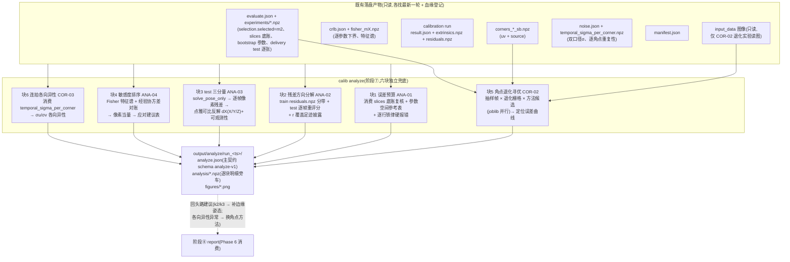

# Phase 5: 误差预算 + 诊断 + 角点提取寻优 - Research

**Researched:** 2026-10-21
**Domain:** 阶段⑦「误差归因」(`calib analyze` 命令):实际误差 vs CRLB 误差预算、残差方向分解、test 集相机坐标系三分量分解、参数敏感度排序、角点合成退化寻优实验
**Confidence:** HIGH(全部结论基于本仓库源码与既有落盘产物逐项核对;少量实验设计参数为带推导的估计,见 Assumptions Log)

## Summary

阶段五是一个"消费为主、一处新建"的阶段:ANA-01~04 的原料在阶段三/四的落盘产物里**已经齐了**——
误差预算要用的逐行像素空间对账底账就在 `output/evaluate/run_20261021_070436/experiments/slices.npz`
(组间重投影散布 `group_uv` + 匹配口径逐行下界 `group_bound_px`,2026-10-20 定案口径),
参数晃动在 `group_params`/`bootstrap.npz`,Fisher 特征谱在 `output/fisher/run_20261019_025859/fisher_m2.npz`
(已存无量纲坐标的协方差特征分解),连拍逐角点 x/y 重复性在
`output/noise/run_20261018_165412/temporal_sigma_per_corner.npz`(80 姿态 × 88 角点 × 2 方向)。
`src/calib/analysis/` 目前只有 7 行模块 docstring,`calib analyze` 在
`src/calib/cli/main.py:1795` 是 `_not_implemented` 占位——骨架位置已留好,本阶段填肉。

真正需要**新建数学**的只有两处:(1) ANA-03 的 test 集相机坐标系三分量分解——用既有的
`model.project_point_jacobian`(每个模型已实现的投影对相机坐标点的解析导数,`models/base.py:65`)
把逐帧像素残差最小二乘反解成相机坐标系三维位移,再用 `A^T A` 特征值给"哪个分量大"的可观测性解释;
(2) COR-02 的合成退化寻优实验——但它的骨架也早已存在:阶段三的受控注入实验
(`noise/injection.py`)就是"改图 → 重检角点 → 与干净参照逐角点比对"的完整范式
(加噪函数 `add_gaussian_noise`、种子三元组推导 `_seed_for`、并行调度、逐副本留痕全部现成),
COR-02 只是把"改图"从加噪声一档扩成 加噪/模糊/低对比 三族、把"定版检测器一种"扩成
"classic 窗口阶梯 + SB 两个候选位"。

**Primary recommendation:** `calib analyze` 照 `calib evaluate` 的成熟体例做(全量配置体、
逐块独立兜底、失败契约照常落盘、json 主契约 + npz 明细旁车 + figures/):六个需求块
(ANA-01/02/03/04 + COR-02/03)各自独立成函数、失败互不拖累;ANA 块纯消费既有产物
(分钟级),COR-02 块是唯一重计算块(约 15–40 分钟,单因素渐进设计 + joblib 并行),
用 quick/full 两档控制(quick 只考选型定案的 m2、抽样帧、单因素栅格;full 全量)。
铁律沿用 findings 结论 4:像素空间逐角点对账是唯一权威判定,参数空间表格只作参考并就地声明
k1–k3 单独比值无意义;任何"实测 < CRLB"硬报错。

## Project Constraints (from CLAUDE.md)

- **通俗中文硬性**:所有文档、报告、代码注释、CLI 帮助用通俗中文;禁软件工程行话;专业术语(Fisher 信息、雅可比、CRLB、特征分解等)首次出现必须就地一句白话解释。
- **技术栈锁死**:Python 3.12 + opencv-python 4.14.x(**锁 <5.0**)+ numpy 2.5.x/scipy 1.18.x 成对锁;matplotlib 出 PNG;joblib 进程并行;typer CLI。**零新依赖**。
- **文件是唯一真相源**:阶段间只通过带血缘(make_lineage:配置指纹 + 上游哈希 + 时间戳)的落盘产物通信;每阶段可独立重跑。
- **目录契约**:input_data/ 只读;config/ 是参数唯一来源(**命令行零算法参数**,D-12);产物写 output/(不进 git)。
- **模块布局**:src/calib/ 下 io/corners/noise/models/solve/evaluation/analysis/visualization/report 与流水线阶段一一对应——阶段⑦的编排统计进 `analysis/`,检测逻辑唯一入口仍是 `corners/detect.py`,图表进 `visualization/`。
- **单一数学源红线(D-06/D-10)**:投影与雅可比只从 `models/` 来,雅可比只从 `make_jacobian_fn` 来;数值差分基准只准出现在 tests/。
- **产物保真(memory 规则)**:逐行明细全量落 npz 旁车,json 只留汇总索引;npz 读写一律 `allow_pickle=False`。
- **人工核查四要素(memory 规则)**:CLI 收尾播报必须给"看哪个文件 / 文件作用 / 具体看哪里 / 好坏判据"。
- **npz pickle 防线、yaml safe_load、中文契约报错、图失败不拦主产物、run 目录留痕不删旧轮**——全部沿既有代码体例。

<phase_requirements>

## Phase Requirements

| ID | Description | Research Support |
|----|-------------|------------------|
| ANA-01 | 误差预算——实际误差 vs CRLB(数据利用率);实测低于理论下界硬报错 | 实测侧 = slices.npz `group_params`(8 组经验σ)+ `group_uv` 组间散布;理论侧 = `group_bound_px` 匹配口径逐行下界 + crlb.json `se`;硬报错复用 `selection.crlb_alert_check` + 逐行违例数;参数空间表按 findings 结论 4 的 crlb_caliber_note 体例就地声明 k1–k3 比值无意义。见 §Pattern 1 |
| ANA-02 | 误差方向分解——按视图/图像区域/径向模式;畸变外推风险显式披露 | 原料 = m2__scipy `residuals.npz`(640×88×2)+ 角点 uv;r 分带 + 覆盖足迹公式已在 findings 结论 5 定案(归一化半径公式 + 判据表);test 侧逐帧 `solve_pose_only` 重算逐角点残差。见 §Pattern 2 |
| ANA-03 | test 误差按相机坐标系 X/Y/Z 分量分解,由投影雅可比/FIM 可观测性给理论解释 | 新建但数学最小:逐帧堆叠 `project_point_jacobian`(N,2,3)→ 最小范数反解三维位移 dX;可观测性 = A^T A 特征值,Z 方向信息最弱即理论解释。见 §Pattern 3 |
| ANA-04 | 内参数敏感度排序(协方差/特征分解)+ 最大敏感维度的应对建议 | fisher_m2.npz 已存无量纲特征谱;经验侧 bootstrap.npz `m2__params`(50,9)+ slices `group_params`(8,9);像素当量换算复用 `experiments._px_dispersion` 方法;应对建议 = findings 结论 5 判据表产品化(自动按覆盖足迹出"补边缘姿态"建议);可选 Fisher 补拍预演(what-if)。见 §Pattern 4 |
| COR-02 | 角点合成退化实验(加噪/模糊/低对比,含 winSize 扫描与 SB 候选)产出定位误差曲线,锁定当前条件最优配置 | 骨架照抄 `noise/injection.py` 范式(改图→重检→逐角点比对);检测唯一入口 `corners/detect.py`;窗口阶梯受 `window.derive_window_frame` 断言约束(2w+1 < 方格边长);SB 候选 = flags 0 与 CALIB_CB_ACCURACY(cv2 4.14.0 本机已确认存在)。见 §Pattern 5 |
| COR-03 | 同姿态连拍角点 x/y 方向重复性各向异性分析落盘 | 原料已存在:`temporal_sigma_per_corner.npz` 的 `sigma_per_corner_all`(80,88,2)——按 `sources` 数组过滤 temporal 来源姿态,算逐角点 σu/σv 与地图/分带汇总。见 §Pattern 6 |

</phase_requirements>

## Architectural Responsibility Map

| Capability | Primary Tier | Secondary Tier | Rationale |
|------------|-------------|----------------|-----------|
| 误差预算表(ANA-01) | analysis/(阶段⑦编排,纯消费既有产物) | — | 对账原料已全部落盘,analyze 只做组装、复核与中文判读,不重解任何方程 |
| 残差方向分解(ANA-02) | analysis/ | visualization/(覆盖足迹叠加图) | 残差结构统计是编排层职责;空间图表归可视化层(matplotlib-only 既定架构) |
| test 三分量分解(ANA-03) | analysis/(编排与统计) | models/(`project_point_jacobian` 唯一数学源)+ solve/scoring(`solve_pose_only`) | 导数公式绝不在 analysis/ 重写——只调模型层接口;逐帧位姿评分复用阶段四评分引擎 |
| 敏感度排序与建议(ANA-04) | analysis/ | noise/fisher.py(FIM/特征谱数学复用) | FIM 组装与谱报告是阶段三已验证数学,分析层只消费特征分解结果并做像素当量换算 |
| 合成退化实验(COR-02) | analysis/(实验编排与统计) | corners/detect.py(检测唯一入口)、visualization/ | 检测逻辑唯一来源红线:analysis/ 只组装退化图并调 detect_*;绝不复制第二份检测实现 |
| 连拍各向异性(COR-03) | analysis/(消费 noise 产物) | visualization/ | 逐角点 x/y 重复性已在阶段三落盘,分析层只做各向异性统计与判读 |
| 图表(REP-01 前置) | visualization/analyze_figs.py(新建) | — | 照 evaluate_figs.py 体例:Agg 后端 + 中文字体三件套;库函数只管画图,失败不拦主产物 |
| 产物契约与 CLI | analysis/artifacts.py(新建)+ cli/main.py analyze 命令体 | — | 照 evaluation/artifacts.py 体例:主 json 契约键先验 + npz 旁车 + 失败契约 |

## Standard Stack

### Core(全部已在栈内,零新依赖)

| Library | Version | Purpose | Why Standard |
|---------|---------|---------|--------------|
| opencv-python | 4.14.0 [VERIFIED: 本机 .venv 运行时] | COR-02 的退化图生成(cv2.GaussianBlur)+ 双检测器重检(findChessboardCorners/cornerSubPix/SB);**锁 <5.0 不动** | 全部角点检测唯一入口;SB 候选位 CALIB_CB_ACCURACY 已确认存在 |
| numpy | 2.5.4 [VERIFIED: 本机] | 分带统计、特征分解、最小范数反解、npz 旁车 | 唯一数组数学 |
| scipy | 1.18.1 [VERIFIED: 本机] | `solve_pose_only` 内部已用的 least_squares(test 帧位姿评分);特征分解走 numpy 即可 | 不新增调用面 |
| matplotlib | 3.11.2 [VERIFIED: 本机] | analyze 全部图表 PNG(Agg 离线) | 可视化层 matplotlib-only 架构决策 |
| joblib | 1.6.0 [VERIFIED: 本机] | COR-02 退化网格的进程并行(经 `evaluation/parallel.py` 的 run_parallel) | 阶段四已定并行体例 |
| pytest | 9.1.1 / ruff 0.17.1 [VERIFIED: 本机] | 测试与 lint | 既有 489+37 测试基线 |

**Installation:** 无——本阶段零新依赖,pyproject.toml 不动。

**Version verification:** 本阶段不安装任何新包;上表版本为本机 .venv 实测(`.venv/bin/python -c "import ...; print(__version__)"`,2026-10-21)。

## Package Legitimacy Audit

本阶段**不安装任何外部包**(零新依赖,全部复用 pyproject.toml 既有锁定集),无需运行 slopcheck 门。
如后续规划中出现的任何新依赖提议,一律按 CLAUDE.md「What NOT to Use」拒绝(autodiff、numba、contrib、Ceres 等),或回到讨论流程。

**Packages removed due to slopcheck [SLOP] verdict:** none
**Packages flagged as suspicious [SUS]:** none

## Architecture Patterns

### System Architecture Diagram(阶段⑦ 数据流)



### Recommended Project Structure

```
src/calib/
├── analysis/                  # 阶段⑦(本阶段从 docstring 骨架填成实模块)
│   ├── __init__.py            # 已有(7 行 docstring)
│   ├── artifacts.py           # 新建:analyze.json 契约键先验 + npz 旁车 + 失败契约(照 evaluation/artifacts.py 体例)
│   ├── budget.py              # 新建:ANA-01 误差预算(消费 slices/crlb,逐行铁律复核)
│   ├── residual_structure.py  # 新建:ANA-02 分带统计 + r 覆盖足迹 + 外推披露
│   ├── test_xyz.py            # 新建:ANA-03 test 三分量反解 + 可观测性
│   ├── sensitivity.py         # 新建:ANA-04 特征方向 → 像素当量 → 应对建议表
│   ├── corner_opt.py          # 新建:COR-02 退化网格编排(检测只调 corners/detect)
│   └── anisotropy.py          # 新建:COR-03 各向异性统计
├── corners/                   # 不动:detect_classic/detect_sb/window 是检测唯一入口
├── visualization/
│   └── analyze_figs.py        # 新建:预算条形/分带曲线/覆盖足迹叠加/XYZ 对比/误差曲线族
└── cli/main.py                # analyze 命令体替换 _not_implemented 占位
config/calibration.yaml        # 新增 analyze: 段(AnalyzeConfig)
tests/test_analysis_*.py       # 新建(见 Validation Architecture)
```

### Pattern 1: ANA-01 误差预算表(实测 vs CRLB,双空间口径)

**What:** 逐内参一行 + 像素空间权威对账一块。铁律(2026-10-20 定案,findings 结论 4):正式判定在**像素空间**——把内参块理论下界经雅可比推到"逐角点重投影位移"与组间实测散布对账;参数空间表格只作参考,且 k1–k3 的单独下界被参数间补偿空间撑大、单独比值无意义(必须随表声明)。

**When to use:** analyze 块 1。**纯消费,零求解**:evaluate 的 slices 段已把底账算好落盘。

**Example(消费面,全部键名已在产物中核实):**

```python
# 数据源(2026-10-21 实测核对):
# output/evaluate/run_20261021_070436/experiments/slices.npz 键:
#   m2__group_params (8, 9)   8 组独立标定的参数  ← 实测σ = 逐参数 std(ddof=1)
#   m2__group_uv     (8, 80, 88, 2)  各组解重投影  ← 实测(像素) = 组间 std
#   m2__group_bound_px (8, 2*80*88)  匹配口径逐行下界  ← 理论(像素)
#   m2__group_se     (8, 9)   逐组参数空间下界(参考表用)
#   m2__param_names  (9,)
# evaluate.json 的 slices.models.m2 已有:empirical_std / crlb_se_mean /
#   crlb_alert(per_param 三统计量 + n_pointwise_violations + lines.hard/soft)
# output/fisher/run_20261019_025859/crlb.json 的
#   models.m2.observation_sets.views640.detector.se (9,)  640 全帧口径下界

# analyze 块1 的职责(不重算,复核 + 组装 + 判读):
# 1) 从 slices.npz 重算逐行比值 = std(group_uv, axis=0) / mean(group_bound_px, axis=0),
#    断言与 evaluate.json 的 crlb_alert 三统计量一致(独立复核,口径漂移当场报错)
# 2) 硬报错执行位:任何统计量 ratio < crlb_alert.lines.hard(0.4207)
#    或 n_pointwise_violations > 0 → 中文 AssertionError(ANA-01 成功判据原文
#    "实测低于理论下界硬报错"),失败契约落盘后退出码 1
# 3) 组装逐内参预算行(像素当量换算见 Pattern 4 的 _px_dispersion 方法):
#    {参数, 经验σ(8组), 经验σ像素当量, bootstrapσ, 位姿抽样σ(source_separation 段),
#     crlb_se(参数空间, 参考列), 利用率比值(仅 fx/fy/cx/cy 有效),
#     crlb_caliber_note 就地声明(照 evaluate slices 的现成文案体例)}
```

**实测数字基准(写测试断言与人工核查判据用)** [CITED: docs/findings.md 结论 1/4 + evaluate run_20261021_070436]:σ_detector = 0.0087 px;逐行实测全部 ≥ 2.8× 下界、零违例;三条统计量实测/下界 = 102 / 1108 / 1444 倍;fx/fy/cx/cy 参数空间利用率 = 实测是下界的 41.5/41.6/361/378 倍;硬线 0.4207 / 软线 0.5564。

### Pattern 2: ANA-02 残差方向分解 + 覆盖足迹披露

**What:** 残差(投影减实测的像素偏差)按三个维度切片:逐视图、图像区域、归一化半径 r 分带;所有空间图叠加"拍到过哪里"的覆盖足迹,畸变外推区(没拍到、参数纯靠猜的区域)显式披露。

**半径与信息权重公式(2026-10-21 定案,findings 结论 5)** [CITED: docs/findings.md]:

```
r = √(((u−cx)/fx)² + ((v−cy)/fy)²)     # 归一化半径:角点到画面中心的距离,以焦距为单位
信息权重 ∝ r⁴(k2)、r⁶(k3)             # 中心观测对高阶畸变近乎失明
当前数据实测:最远 r=0.685;四角方向 r=0.796; r>0.5 占 21.1% 却贡献 k2 信息的 61.4%;
             r 0.69–0.80 零观测 = 纯外推区
判据表:r≤0.4 晃动≤0.02px 现状够用;r 0.5–0.685 记入预算;r>0.69 必须先补覆盖
```

**Example(实现要点):**

```python
# train 侧:直接读 output/calibration/run_20261018_163713/m2__scipy/residuals.npz
#   residuals (640, 88, 2)  ← 行序 = extrinsics.npz 的 image_ids(血缘对齐)
# test 侧:residuals.npz 里没有 test 帧,需逐帧重算——
#   对 65 张 test 逐张调 solve_pose_only(已验证引擎,solve/scoring.py:79)
#   拿到 (rvec, tvec) 后用 model.project(transform_to_camera(...)) 回代出逐角点残差
#   (残差=投影−实测,与 compute_result_metrics 同一把尺;毫秒级/帧,65 帧秒级)
# 分带统计:按 r 分带(如 [0,0.2,0.4,0.6,0.8])与按画面象限/内外环分桶,
#   每带出 RMS/中位/最大 + u/v 均值偏移(系统性偏移与散布分开看)
# 覆盖足迹:从 corners_train_sb.npz 的 uv + 选型定案 m2 的 fx/fy/cx/cy
#   (归一化基准要随产物落盘声明——findings 结论 5 用的是标定 run_20261018_163713 m2 解)
#   算逐观测 r 直方图 + 画面覆盖图;每张空间图统一叠"观测足迹 + 外推区阴影"
# 外推披露(自动文案):最远观测 r、四角 r、外推区像素占比、
#   按 r⁴ 律外推的 k2 晃动折算(结论 5 判据表数值)
```

### Pattern 3: ANA-03 test 误差相机坐标系三分量分解(本阶段唯一新建数学)

**What:** 每张 test 照片的逐角点像素残差,经投影对相机坐标点的导数反解成"棋盘整体挪动多少能解释这些残差"的三维位移 dX=(dX, dY, dZ);哪个分量大,由该方向的信息量(雅可比奇异值)给理论解释。

**数学(仅用既有接口,零新导数公式):**

```
逐帧:残差向量 r ∈ R^{2N} (N=88),堆叠点雅可比 A ∈ R^{2N×3},
      A 的每行 = model.project_point_jacobian(pts_cam, params)[点i] 的 (2,3) 块
      (接口已存在:models/base.py:65,返回 (N,2,3),各模型解析式+数值校验测试已锁)
最小范数反解:dX = (AᵀA)⁻¹ Aᵀ r          # 像素偏差 → 相机坐标系位移(单位=物点单位 mm)
可观测性:AᵀA 的特征分解——最小特征值方向 ≈ 深度方向(单视角天然看不远),
      理论放大倍数 = 1/特征值;dX 的各分量标准差 = σ_px·sqrt(diag((AᵀA)⁻¹))
判读:三分量原始量级 + 按理论σ归一(z 分数形式)并排——
      "Z 量大但可观测性差、放大倍数高"与"Z 分数也大"是两种结论,必须分开呈现
聚合:65 帧逐帧 |dX_x|/|dX_y|/|dX_z| 的中位/最大表 + 理论σ中位表
```

**关键坑:** 单视角对深度(Z)方向几乎盲——反解出的 dZ 数值天然被 1/小奇异值放大,直接报"Z 最大"是误导;报告必须带可观测性归一列与"该帧深度方向放大倍数"。test 集参加过选型(轻微乐观偏差,evaluate.json 的 agreement.note 已有先例文案),ANA-03 报告照例声明。

### Pattern 4: ANA-04 敏感度排序 → 像素当量 → 应对建议

**What:** 参数敏感度 = "往哪个参数组合方向挪,解最刹不住车"。两条独立证据对账后落排序表,每条最大敏感方向配一条可操作建议。

**数据与换算(全部既有):**

```python
# 理论侧:output/fisher/run_20261019_025859/fisher_m2.npz 已存
#   eigvals_cov (9,) / eigvecs_cov (9,9)  ← 无量纲坐标(像素参数÷焦距)的协方差特征分解
#   param_names (9,)                      ← 特征向量第 i 行 = 第 i 参数的载荷
# 经验侧:bootstrap.npz m2__params (50, 9) 的样本协方差特征分解
#   slices.npz m2__group_params (8, 9) 同法(样本少,作旁证)
# 对账:两边的最大特征值方向载荷表并排——findings 结论 1 已实证它们一致
#   (k2/k3 方向,bootstrap k2/k3 标准差是分组口径的 13–14 倍,但软方向相同)
# 像素当量(必须,findings 结论 1 反面教材:近零参数 p1/p2 看百分比晃 3–7% 但
#   画面影响 <0.02px——不上像素当量天平的敏感度排序没有判读价值):
#   沿方向 v 取 ±k·σ 步长扰动参数 → 用参考位姿投影 88 角点 → 最大位移
#   (复用 experiments._px_dispersion 同一方法;参考位姿按 findings 结论 1 惯例
#    取"第 0 视图",并在产物里声明)
# 应对建议表(规则表产品化,来源 = findings 结论 5 判据表 + pipeline.md 回头路):
#   软方向载荷集中在 k2/k3 → 查本块算出的覆盖足迹:r>0.69 零观测 →
#     建议"补 N 个够到四角(r≥0.75)的姿态,不必重拍全部;每姿态 1–2 张就够(结论 1)"
#   fx/cy 类像素参数耦合 → 建议"补转角多样性姿态"(pipeline.md 回头路)
#   近零参数(p1/p2)出现在载荷表 → 像素当量 < 0.05px 时建议"不治",
#     并注明"相对百分比无意义"的反面教材
# 可选增强(Claude discretion,不进成功判据):Fisher 补拍预演——
#   用 delivered 参数合成 K 个"棋盘够到画面四角"的虚拟位姿观测( transform_to_camera
#   + project 生成理想角点 ),并入观测集重算 marginalized_fisher → CRLB 压缩比,
#   给"补几个姿态能再压多少"的定量预期。FIM 组装秒级,成本低;但合成位姿属"假设"
#   而非"实测",产物必须声明证据链性质(照结论 5 手段清单第 2 条的声明纪律)
```

### Pattern 5: COR-02 角点合成退化寻优实验(唯一重计算块)

**What:** 把真实拍到的棋盘照片人为变差(加噪/模糊/降对比),用各候选检测配置重新提角点,与参照逐角点比对,画出"退化强度 → 定位误差"曲线,用数据证明当前配置(detector 级 σ=0.0087px 的 SB 生产路线)在当前条件最优。

**骨架照抄 `noise/injection.py` 的完整范式** [VERIFIED: src/calib/noise/injection.py]:

| 注入实验已有 | COR-02 复用方式 |
|---|---|
| `add_gaussian_noise`(float 域加噪→裁剪→回 uint8 量化) | 加噪族直接复用;模糊族 = cv2.GaussianBlur(σ_px 档);低对比族 = float 域 `mid + (img−mid)·gain` → 裁剪 → 回 uint8(量化步骤同样不能省,理由同注入实验 Pitfall 4) |
| `_seed_for(image_id, level, rep)` 三元组种子 | 副本不落盘、同种子逐位复现的正当性来源,扩成 (image, 退化单元, 方法, 重复) 四元组 |
| 检测只调 `detect_sb`/`detect_classic` | **方法候选 = 检测入口参数,不新增检测实现**:classic 路线换 winSize(阶梯),SB 路线换 flags |
| ProcessPoolExecutor + 逐副本 NaN/失败留痕 | 换 `evaluation/parallel.py` 的 run_parallel(阶段四统一体例;worker 内须再上 `cv2.setNumThreads`,并行子进程是全新进程——04-02 教训) |

**实验设计(推荐:单因素渐进 OFAT + 少量交叉角):**

```
帧抽样:按姿态抽 30–40 帧(种子可复现),覆盖 r 从小到大(角点寻优关心边缘)
退化族(单因素各一 sweeping,其余保持干净):
  加噪 σ ∈ {0, 2, 4, 8, 16, 32, 64} 灰阶(对数感网格,0=校准档)
  模糊 GaussianBlur σ_px ∈ {0, 1, 2, 4}
  低对比 gain ∈ {1.0, 0.6, 0.35, 0.2}
方法候选(全部过 canonicalize,同编号同物理点):
  classic × winSize 阶梯 {3, 5, 7, 9, 11, 13} 中满足 2w+1 < 本帧 sq_px 的档
    (硬断言来自 window.derive_window_frame;超档位直接不进候选,不报错)
  SB flags=0(生产位)与 SB+CALIB_CB_ACCURACY(精化位,cv2 4.14.0 本机已确认存在;
    该 flag 语义按"SB 额外亚像素精化"设计并在计划里加 5 分钟实测确认 [ASSUMED])
参照(双参照并行落盘,防口径偏向,见 Open Questions Q1):
  a) 各方法自己对干净图的检出(量"退化敏感度")
  b) 生产 SB 干净检出(量"相对交付角点的绝对偏移")
指标:逐角点欧氏位移 → 每单元 RMS/中位/最大/95 分位 + r 分带切片 + u/v 分量
  (x/y 分量顺带服务 COR-03 的各向异性证据链)
规模估算:36 帧 × 14 退化单元 × 8 方法 ≈ 4000 次检测;
  注入实验实测吞吐约 5 次检测/秒(8 workers,23040 次/4632s,含读图),
  classic+阶梯慢于 SB,估 15–40 分钟 [ASSUMED: 由注入实测吞吐外推]
quick/full:quick 用上表档位;full 加交叉单元(最坏噪×最坏糊)、
  加密帧抽样、SB_EXHAUSTIVE 候选
产物:corner_opt 段进 analyze.json(每方法×单元的三统计量汇总)+
  analysis/corner_opt.npz 逐单元逐帧逐角点位移(产物保真)+ figures/ 误差曲线族
"锁定最优"判读文案:在退化强度未显著劣化的档位内,比较各方法误差曲线;
  生产配置(SB,winSize 由 sq_px 推导)若不在曲线上占优,如实报告并给切换建议——
  结论由数据出,不预设
```

### Pattern 6: COR-03 连拍各向异性(纯消费块)

**What:** 同一姿态连拍的同一角点,横向(u)与纵向(v)的重复定位散布之比——各向异性。

```python
# 原料(已落盘,2026-10-21 核实):
# output/noise/run_20261018_165412/temporal_sigma_per_corner.npz
#   pose_ids (80,) / sigma_per_corner_all (80, 88, 2) / sources (80,) <U8
#   (sources 取值 temporal / immerkaer_transfer;折算姿态没有真实连拍重复,
#    sigma_per_corner 行可能是 NaN——必须按 sources=="temporal" 过滤)
# 统计:逐角点 aniso = σu/σv(防零除:分母 clamp 到 detector σ 量级下限);
#   汇总中位/分位;按 r 分带、按画面象限切片(与 ANA-02 同一分带器,一处实现两处用)
# 判读:各向异性显著 >1 的区域在哪、是否与图像内容方向相关;
#   对照 detector σ=0.0087px 给物理量级白话(memory 规则:误差给参照物量级)
# 图:逐角点各向异性地图(带覆盖足迹)+ 直方图
```

## Don't Hand-Roll

| Problem | Don't Build | Use Instead | Why |
|---------|-------------|-------------|-----|
| 角点检测与亚像素精化 | analysis/ 里重写检测循环或直接调 cv2 | `corners/detect.py` 的 `detect_classic`/`detect_sb`(含规范化、缺陷闸门、SB 禁二次精化防线) | 检测唯一来源红线;绕过它等于丢掉规范化与缺陷闸门两道防线 |
| 窗口阶梯合法域 | 手写"窗口多大合适" | `window.derive_window_frame`/`estimate_sq_px`(断言 2w+1 < 方格边长) | 头号陷阱(窗口吞邻角→看不见的系统偏差)已有数学防线 |
| test 帧位姿评分 | 重写 PnP/精化 | `solve/scoring.solve_pose_only`(反投影初值路线,已修过 4.82px 错误盆地真实案例) | 模型无关、已验证;重写必然踩同一个坑 |
| 逐内参 CRLB/特征谱 | 从 Jacobian 重新组装 FIM | `fisher_m2.npz` 已存的 `eigvals_cov/eigvecs_cov` + `crlb.json se`;要重算只有一种情况(what-if 补拍预演),那时调 `marginalized_fisher` | 单一数学源;FIM 组装的稀疏性/奇异防护/Schur 路线都有测试锁定 |
| "实测好于理论"告警统计 | 新写卡方线 | `selection.crlb_alert_check`(双档显著性、df 自适应) | ANA-01 硬报错必须与 evaluate 同一条判定线,两套判据必打架 |
| 像素当量换算 | 逐参数手写位移公式 | `experiments._px_dispersion` 方法(投影位移作公共货币) | findings 结论 1 的反面教材(p1/p2 百分比陷阱)已用此法销案 |
| 高斯加噪/种子推导 | 新写噪声函数 | `injection.add_gaussian_noise` + `_seed_for` 三元组模式 | 量化步骤与可复现承诺是实测踩坑换来的 |
| npz 旁车/失败契约/血缘 | 新写落盘层 | 照 `evaluation/artifacts.py` 体例新建 `analysis/artifacts.py`;`util/lineage.make_lineage` | 项目统一防线(allow_pickle=False、契约键先验、中文报错) |
| 图表中文字体/离线后端 | 每图自带设置 | 照 `evaluate_figs.py` 头三件套(Agg 先于 pyplot、字体清单、unicode_minus) | 已实测本机字体在列 |

**Key insight:** 阶段五的绝大多数"数学"在阶段三/四已经落盘成产物或沉淀成函数;analyze 的正确姿态是**对账者**而不是重算者——凡是发现"要重新推导某个已存在的量",先找它在哪个 npz/json 里。

## Common Pitfalls

### Pitfall 1: CRLB 口径错配(项目最高优先铁律)
**What goes wrong:** 拿时域口径 σ(≈0.30px,连拍整帧共模偏移)或外参边际化矩阵给分组实测对账 → 下界虚高 35 倍 → "实测低于理论下界"假告警满天飞,或反过来把真违例吞掉。
**Why it happens:** σ 有双口径(detector 0.0087 / temporal 0.2995),FIM 有三种(内参块/边际化/加权);组合错了不报错只算错。
**How to avoid:** 唯一权威口径 = **检测器级 σ × 内参信息块下界 × 雅可比推到逐角点重投影位移**(2026-10-20 定案);analyze 从 slices.npz 的 `group_bound_px` 取数(口径已固化在产物里),复核时对照 evaluate.json `slices.models.m2.crlb_alert` 三统计量,不一致当场中文报错。σ 只从 `noise.json` 的 `sigma_detector_corner` 读。
**Warning signs:** 任何比值 < 1;逐行违例 n_pointwise_violations > 0。
[VERIFIED: experiments.py:842-876 的 `_sigma_detector_from_noise` 铁律注释 + findings 结论 4]

### Pitfall 2: k1–k3 参数空间比值无意义
**What goes wrong:** 误差预算表给 k1/k2/k3 排"利用率"(实测σ/下界),读者据此判断"畸变参数定得很准/不准"——两说都是错的,单独下界被参数间补偿空间撑大,不是噪声小。
**How to avoid:** 参数空间列就地附 `crlb_caliber_note`(照 evaluate slices 现成文案);利用率比值只对 fx/fy/cx/cy 给出,k1–k3 该列置 null + 说明;正式判定引像素空间块。
[VERIFIED: experiments.py:1231-1241 + findings 结论 4]

### Pitfall 3: 近零参数的百分比陷阱
**What goes wrong:** 敏感度排序按相对百分比呈现 → p1/p2 晃 3–7% "最不稳",实际画面影响 <0.02px。
**How to avoid:** 敏感度一律换算像素当量再上天平(Pattern 4);特征方向载荷表 + 像素当量列并排。
[CITED: docs/findings.md 结论 1 反面教材]

### Pitfall 4: winSize 扫描越过方格边长
**What goes wrong:** 退化实验里 classic 窗口取大档 → 搜索区吞邻角 → 每个角点同向系统性拉偏 → **重投影误差完全看不出来**(本项目头号陷阱的由来,158294 事故帧)。若拿"重投影 RMS"当曲线指标,会得出"大窗口更好"的颠倒结论。
**How to avoid:** 阶梯上限按每帧 `sq_px` 用 `derive_window_frame` 同式推导,`2w+1 < sq_px` 不满足的档不进候选;指标用"与参照的逐角点位移"而不是重投影。
[VERIFIED: corners/window.py 模块头 + detect.py 事故注释]

### Pitfall 5: 对 SB 输出做二次亚像素精化
**What goes wrong:** 把 SB 角点再喂 cornerSubPix "提精度" → 两种角点模型互相污染,精度反降。
**How to avoid:** SB 候选位只动 flags(如 CALIB_CB_ACCURACY),绝不把 SB 结果送进 `_subpix_refine`(该函数全仓库只允许 classic 分支调用,有源码防线测试)。
[VERIFIED: corners/detect.py 模块头与 `_subpix_refine` 注释]

### Pitfall 6: quick 档产物只含当选模型
**What goes wrong:** analyze 假设 slices/bootstrap 里有全部四个模型 → 当前 evaluate run_20261021_070436 是 quick 档,实验只有 m2(`meta.experiment_models == ["m2"]`,已核实),KeyError。
**How to avoid:** analyze 的目标模型从 `evaluate.json` 的 `selection.selected` 读,细节 npz 键按 `m2__` 前缀拼;full 档重跑 evaluate 后才有多模型明细。
[VERIFIED: evaluate run_20261021_070436 meta 与 experiments/*.npz 键名]

### Pitfall 7: ANA-03 的 Z 分量解释翻车
**What goes wrong:** 反解出 dZ 最大就直接报"误差主要在深度方向"——实际单视角对深度几乎盲,数值被 1/小奇异值放大,"Z 大"可能只是可观测性差的数学必然。
**How to avoid:** 原始量级与可观测性归一(z 分数)并排呈现;每帧报深度方向放大倍数;"哪个分量大"的结论必须同时引用 AᵀA 特征值证据。
**Warning signs:** AᵀA 条件数 >1e4 的帧,其 dZ 不具备解释力,单独标注。

### Pitfall 8: 连拍相关性的信息高估
**What goes wrong:** analyze 若需要自己组装 FIM(what-if 预演),把同姿态 8 连拍当独立观测 → 信息量虚高。
**How to avoid:** 正式口径 640 全帧 FIM 已有;对照口径 80 姿态聚合版也在 fisher npz(`F_marg_poses80`);what-if 的合成姿态天然独立,不受此坑影响,但报告须引两版差值 = 连拍相关性损耗的既有结论。
[VERIFIED: fisher.py:325-330 D-01 注释]

### Pitfall 9: 各向异性数据源混入折算姿态
**What goes wrong:** COR-03 直接对 `sigma_per_corner_all` 全表统计 → `immerkaer_transfer` 来源姿态没有真实连拍重复(行含 NaN 或折算值),污染各向异性。
**How to avoid:** 按 `sources == "temporal"` 过滤;NaN 行显式排除并计数落盘。
[VERIFIED: temporal_sigma_per_corner.npz 键结构 + noise.json 来源标注契约]

### Pitfall 10: 并行子进程的确定性丢失
**What goes wrong:** COR-02 并行检测时并行与串行结果末位漂移 → 同种子重跑不一致,违反项目确定性红线。
**How to avoid:** 任务元组带 `cv2_threads`,worker 内再上 `cv2.setNumThreads`(进程级补全,04-02 教训);走 `run_parallel`(loky + inner_max_num_threads 已封装);种子四元组推导(Pattern 5)。
[VERIFIED: evaluation/parallel.py + experiments.py worker 注释]

### Pitfall 11: 血缘与串轮
**What goes wrong:** corners/care_calibration/fisher/evaluate 各有最新轮,analyze 随手各取最新可能拼出"不同血缘的混搭对账"(例如新 corners 轮 + 旧标定轮,r 归一化口径漂移)。
**How to avoid:** 照 evaluate() 的上游定位体例:各阶段找最新一轮 + 全部登记进 make_lineage upstream;归一化基准(用哪轮哪个模型的 fx/fy/cx/cy)显式写进产物 meta。特别地:r 归一化建议优先用 evaluate delivery 的 `final_params`(与选型同源),并在 meta 记录与 findings 结论 5 所用基准(标定 run_20261018_163713 m2)的一致性核对结果。
[VERIFIED: cli/main.py evaluate 命令上游定位段 1276-1332]

### Pitfall 12: 图是附加产物
**What goes wrong:** 出图失败(字体缺、数据空)让整个 analyze 崩溃,数据产物陪葬。
**How to avoid:** 逐图独立 try/except + 中文播报"图未生成(不影响数据产物)",照 evaluate 三图的既定体例。
[VERIFIED: cli/main.py 1669-1691]

## Code Examples

### 逐帧像素残差 → 相机坐标系三分量(ANA-03 核心,全既有接口)

```python
# 来源:接口签名核实于 models/base.py / solve/scoring.py / solve/residuals.py(2026-10-21)
import numpy as np
from calib.models import create_model
from calib.models.base import transform_to_camera
from calib.solve.scoring import solve_pose_only

model = create_model("m2")
params = np.array([final_params[n] for n in model.param_names])  # delivery.m2.final_params

def frame_xyz(uv_view: np.ndarray, objp: np.ndarray):
    """单张 test 照片:像素残差 → 相机坐标系位移三分量 + 可观测性。"""
    rvec, tvec, _rms = solve_pose_only(uv_view, objp, params, model)  # 只估位姿(内参固定)
    pts_cam, _ = transform_to_camera(objp, rvec, tvec)                # (88,3) + 位姿导数(不用)
    uv_pred = model.project(pts_cam, params)                          # 唯一数学源投影
    resid = (uv_pred - uv_view).ravel()                               # (176,) 逐角点像素残差
    J_pt = model.project_point_jacobian(pts_cam, params)              # (88,2,3) 解析导数
    A = J_pt.reshape(2 * len(uv_view), 3)                             # 堆叠 (176,3)
    ata = A.T @ A
    dX = np.linalg.solve(ata, A.T @ resid)                            # 最小范数反解 (3,)
    sigma_theory = np.sqrt(np.diag(np.linalg.inv(ata)))               # 理论σ(dX 各分量)
    eigvals = np.linalg.eigvalsh(ata)                                 # 可观测性:最小特征值方向
    return dX, sigma_theory, eigvals
    # 呈现:|dX| 三分量(原始 mm 量级)+ dX/sigma_theory(z 分数)+ 深度放大倍数
```

### 退化单元应用(复用注入实验的量化纪律)

```python
# 来源:noise/injection.py add_gaussian_noise 的量化纪律(float 域 → 裁剪 → 回 uint8)
def apply_degradation(gray_u8: np.ndarray, family: str, level: float,
                      rng: np.random.Generator) -> np.ndarray:
    """给灰度图施加一族一档退化;uint8 量化收尾与真实采集链路对齐,不能省。"""
    arr = gray_u8.astype(np.float64)
    if family == "noise":
        out = arr + rng.normal(0.0, level, size=arr.shape)       # 复用 add_gaussian_noise 语义
    elif family == "blur":
        k = int(2 * round(3.0 * max(level, 1e-6)) + 1)           # 核径 ≈ 6σ+1,σ=0 时恒等
        out = cv2.GaussianBlur(arr, (k, k), level) if level > 0 else arr
    elif family == "contrast":
        mid = 128.0
        out = mid + (arr - mid) * level                           # gain:1.0=不动
    else:
        raise ValueError(f"未知退化族 {family!r}(支持 noise/blur/contrast)")
    np.clip(out, 0.0, 255.0, out=out)
    return np.rint(out).astype(np.uint8)
```

### r 覆盖足迹与信息权重(ANA-02/04 共用,公式定案于 findings 结论 5)

```python
# 来源:docs/findings.md 结论 5 口径行(2026-10-21);归一化参数来源须随产物声明
def radius_footprint(uv: np.ndarray, fx: float, fy: float, cx: float, cy: float):
    """归一化半径 r 与 k2 信息权重(r⁴)。uv (M,2) 为角点像素坐标。"""
    r = np.sqrt(((uv[:, 0] - cx) / fx) ** 2 + ((uv[:, 1] - cy) / fy) ** 2)
    return r, r ** 4
# 判读基线(当前数据):最远观测 r=0.685;画面四角 r≈0.796;r>0.5 观测占 21.1%
# 却承载 k2 信息 61.4%;r∈[0.69,0.80] 零观测 = 纯外推区(披露文案自动生成)
```

## Runtime State Inventory

> 不适用:本阶段是纯新增分析能力(新模块/新命令体/新产物),无改名/重构/迁移内容。grep 审计之外无运行态残留需要处置——`output/` 下既有轮次按 memory 规则保留不动(旧轮不删,结论以 docs/findings.md 为准)。

## State of the Art

| Old Approach | Current Approach | When Changed | Impact |
|--------------|------------------|--------------|--------|
| 参数空间逐参数 CRLB 对账(k1–k3 比值) | 像素空间逐角点重投影位移对账(内参块下界经雅可比下推) | 2026-10-20 定案 | ANA-01 必须以像素空间为正式判定;参数表降为参考并附口径声明 |
| 时域 σ 进 CRLB | 检测器级 σ_detector_corner=0.0087px | 2026-10-20 | 口径错配是本项目判"实测好于理论"假告警的头号来源 |
| 温启动提速实验 | 冷启动(真实数据否决温启动) | 2026-10-21 | analyze 不做任何重求解,此坑天然避开;但解读结论 3 时须引用 |
| test RMS 简单优先选型(三判据降第二意见) | selection.method=test_rms_simplicity,selected=m2 | 2026-10-21 | analyze 的目标模型读 `selection.selected`,不自己选模型 |

**Deprecated/outdated:**
- 结论 4 销账前遗留的"匹配口径 CRLB 重跑"待办已完成(run_20261021_070436 落账)——analyze 不需要补跑 evaluate,直接消费即可 [VERIFIED: STATE.md Session Continuity + evaluate.json crlb_alert 存在]

## Assumptions Log

| # | Claim | Section | Risk if Wrong |
|---|-------|---------|---------------|
| A1 | `cv2.CALIB_CB_ACCURACY` 的语义 = SB 检出后追加亚像素精化(flag 存在性已本机核实,语义来自训练知识) | Pattern 5 / COR-02 | SB 候选位对比无差异或语义不同 → 实验少了有效候选;计划首个任务加 5 分钟双帧实测确认即可销险 |
| A2 | COR-02 规模估算 15–40 分钟(由注入实验实测吞吐 5 检测/秒 @ 8 workers 外推,classic 阶梯更慢) | Pattern 5 | 耗时偏差 2× 以内可接受;若 classic 检测远慢于预期,砍帧抽样或档位即可,不影响设计 |
| A3 | 最小范数反解 dX=(AᵀA)⁻¹Aᵀr 在 88 角点全网格下数值稳定(条件数由逐帧报告,不稳定帧单独标注) | Pattern 3 | 个别大倾角帧 AᵀA 病态 → 该帧三分量不可解释;已设计逐帧条件数披露与失败占行,最坏是"少几帧可解释样本" |
| A4 | test 侧逐帧重评分的毫秒级耗时假设(65 帧秒级完成;依据 solve_pose_only 为 6 参数小最小二乘) | Pattern 2/3 | 若实测慢(强畸变牛顿迭代多),仍为分钟级,不构成风险 |
| A5 | Fisher 补拍预演(what-if)的合成位姿能代表真实"够到四角"的拍摄(几何上由投影约束反推位姿,但未拍过) | Pattern 4 可选 | 预演数字仅作参考预期;已按结论 5 手段 2 的声明纪律要求产物注明"假设非实测"。若用户不接受任何合成证据,砍掉此可选项,ANA-04 仍达标 |
| A6 | analyze 输出目录命名 `output/analyze/run_<ts>/`(pipeline.md 第⑦行写的是 "analysis/*.json",本方案以 analyze.json 主契约 + analysis/ 明细子目录落地并在阶段收尾同步 pipeline.md——收尾清单本来就要求同步) | Artifact Contract | 纯命名层;阶段收尾同步文档后无歧义 |

## Open Questions (RESOLVED)

1. **COR-02 的参照口径(定位误差相对谁?)**
   - What we know: 无绝对真值;注入实验用"各方法自己的干净检出"当基线。若 COR-02 沿用,则衡量的是"退化敏感度"而非"绝对精度";若统一用生产 SB 干净检出,则对 SB 本家有零点偏好。
   - What's unclear: 用户更认可哪种口径作为"最优"的判据。
   - Recommendation: 双参照并行落盘(方案已在 Pattern 5 定型):方法自参照画敏感度曲线(主曲线),相对生产 SB 的偏移表作旁证(跨方法绝对偏移)。判读文案分开表述。此问题留 discuss-phase 或计划 checkpoint 一句话确认即可,不阻塞规划。
   - **RESOLVED(2026-10-21,裁定①):** 双口径并报(方法自参照 `_self` 主曲线 + 生产 SB 参照 `_prod_sb` 旁证),按 Recommendation 落地 → 05-05。

2. **Fisher 补拍预演(what-if)做不做**
   - What we know: 成本极低(FIM 秒级)、与 findings 结论 5"动手前先查 CRLB"直接呼应;但属合成证据。
   - Recommendation: 做,但作为 ANA-04 的附加产物并带"假设非实测"声明(见 A5);用户若不要,砍除不影响任何成功判据。
   - **RESOLVED(2026-10-21,裁定②):** 做,仅 full 档,产物强制带"合成假设非实测"声明 → 05-04。

3. **COR-02 是否需要"标定级端到端"验证(用退化角点重标定看内参变化)**
   - What we know: 端到端证据最强,但每格一次完整标定(秒级~百秒级)× 网格 = 小时级;角点级误差曲线 + 既有"窗口偏差不可见于重投影"知识已覆盖主要风险。
   - Recommendation: 不进默认范围;可在 full 档留一个可选开关(对最优/最劣两档配置各做一次小样重标定对比)。deferred 到 discuss。
   - **RESOLVED(2026-10-21,裁定③):** 不进 Phase 5 默认范围;分析结论只给"建议回环"提示,实际回环动作归 Phase 6。

4. **analyze 是否接管"run-all 接线"**
   - What we know: run-all 现停在阶段⑤(crlb.json 为止);REP-03(Phase 6)才要求全流水线一条命令。
   - Recommendation: Phase 5 不动 run-all;analyze 作为独立命令交付,接线归 Phase 6。
   - **RESOLVED(2026-10-21,裁定④):** Phase 5 不动 run-all,接线归 Phase 6(REP-03)。

## Environment Availability

| Dependency | Required By | Available | Version | Fallback |
|------------|------------|-----------|---------|----------|
| Python 3.12 venv | 全部 | ✓ | 3.12.13 | — |
| opencv-python | COR-02 / 全部 | ✓ | 4.14.0(<5.0 锁) | — |
| numpy / scipy | 全部 | ✓ | 2.5.4 / 1.18.1(成对锁) | — |
| matplotlib | 图表 | ✓ | 3.11.2(Agg + Noto Sans CJK SC 实测在字体清单) | — |
| joblib | COR-02 并行 | ✓ | 1.6.0 | 串行回退(run_parallel max_workers<=1) |
| pytest / ruff | 验证 | ✓ | 9.1.1 / 0.17.1 | — |
| input_data/ 705 张原图 | COR-02 读图、test 重评分 | ✓(集成测试口径) | — | 无集成数据时全部合成数据单测仍可跑 |
| 既有产物轮次 | ANA 块消费 | ✓(run_20261021_070436 等,已逐键核实) | — | analyze 缺上游当场中文报错(照 evaluate 体例) |

**Missing dependencies with no fallback:** 无。
**Missing dependencies with fallback:** 无。CPU 20 核(实测),`evaluate_max_workers: 12` 的既有压测结论(单求解约 0.9GB 内存)可沿用为 analyze 并行上限依据。

## Validation Architecture

### Test Framework

| Property | Value |
|----------|-------|
| Framework | pytest 9.1.1(项目标记:`integration` = 需真实 input_data 的慢测试) |
| Config file | pyproject.toml `[tool.pytest.ini_options]`(testpaths=tests,markers 已定义) |
| Quick run command | `.venv/bin/python -m pytest tests/test_analysis_<块>.py -x -q -m "not integration"` |
| Full suite command | `.venv/bin/python -m pytest -q`(526 收集:489 非集成 + 37 集成,2026-10-21 实测) |
| Lint | `.venv/bin/ruff check src tests`(line-length 100) |

### Phase Requirements → Test Map

| Req ID | Behavior | Test Type | Automated Command | File Exists? |
|--------|----------|-----------|-------------------|-------------|
| ANA-01 | 预算行组装正确;实测<CRLB 触发硬报错;k1–k3 比值列 null+声明;与 evaluate.json crlb_alert 复核一致 | unit | `.venv/bin/python -m pytest tests/test_analysis_budget.py -x -q` | ❌ Wave 0 |
| ANA-02 | r 分带统计正确(合成网格已知分带);覆盖足迹数值;外推区判定与披露文案 | unit | `.venv/bin/python -m pytest tests/test_analysis_residual.py -x -q` | ❌ Wave 0 |
| ANA-03 | 反解恒等式(合成 A、已知 dX 生成残差 → 反解恢复 dX);可观测性理论σ与蒙特卡洛对齐(粗容差);Z 弱可观测被正确标注;失败帧占行 | unit | `.venv/bin/python -m pytest tests/test_analysis_test_xyz.py -x -q` | ❌ Wave 0 |
| ANA-04 | 特征方向→像素当量换算(对称扰动投影位移);建议规则表(k2/k3→补边缘、近零参数→不治)分支正确 | unit | `.venv/bin/python -m pytest tests/test_analysis_sensitivity.py -x -q` | ❌ Wave 0 |
| COR-02 | 退化单元数值正确(已知噪声种子可复现、模糊恒等档、对比度端点);窗口阶梯合法域过滤;误差统计正确;网格编排小样冒烟(合成棋盘图,串行) | unit | `.venv/bin/python -m pytest tests/test_analysis_corner_opt.py -x -q` | ❌ Wave 0 |
| COR-03 | 各向异性计算(合成 σ 场已知比值);temporal 来源过滤;NaN 排除计数 | unit | `.venv/bin/python -m pytest tests/test_analysis_anisotropy.py -x -q` | ❌ Wave 0 |
| 全块 | CLI analyze 命令:tmp_path 造假上游产物树 → 六块跑通、契约键全、失败契约体;缺上游中文报错 | unit(smoke) | `.venv/bin/python -m pytest tests/test_analysis_cli.py -x -q` | ❌ Wave 0 |
| 全块 | 真实数据全链 analyze(读既有 output/ 轮次)+ 逐键契约断言 | integration | `.venv/bin/python -m pytest tests/test_analysis_realdata.py -q -m integration` | ❌ Wave 0(末期) |

### Sampling Rate

- **Per task commit:** 该任务对应测试文件的 quick 命令 + `ruff check`
- **Per wave merge:** `.venv/bin/python -m pytest -q -m "not integration"`(489 基线全绿不回退)
- **Phase gate:** 全量含 integration 绿;真实数据 `calib analyze` 跑一轮 + 人工核查四要素播报(成功判据 1–5 逐条对账,像 04-06 的收口方式)

### Wave 0 Gaps

- [ ] `tests/test_analysis_budget.py` 等 8 个新测试文件(上表)——随对应实现任务同 Wave 或先行
- [ ] 合成棋盘图 fixture(`cv2` 画黑白格 + 已知角点),供 COR-02 单测不依赖 input_data
- [ ] 无需新装框架/依赖(pytest/ruff 已在 dev 组)

## Security Domain

`security_enforcement: true`(config.json),ASVS Level 1。本项目为**离线数值批处理工具,无网络/无会话/无用户输入面**,绝大多数 ASVS 类目不适用,如实映射:

### Applicable ASVS Categories

| ASVS Category | Applies | Standard Control |
|---------------|---------|-----------------|
| V2 Authentication / V3 Session / V4 Access Control | no | 无网络服务、无多用户概念;文件系统权限即边界(offline 工具,Phase 1~5 一贯口径) |
| V5 Input Validation | **yes** | yaml `safe_load`(禁 yaml.load,io/config.py 已锁);npz 读写强制 `allow_pickle=False`(防 pickle 任意代码执行,全仓既定防线,analyze 读旁车 npz 必须沿用);上游产物缺键/失败轮当场中文报错不静默;COR-02 退化参数入口校验(档位/增益有限正值) |
| V6 Cryptography | no | 不涉加密;sha256 仅作血缘完整性指纹(util/lineage.py),非安全用途 |
| V7 Errors & Logging | **yes** | 失败契约体例:失败也落盘、数值字段 null + 中文 failure_note;绝不把原始异常静默吞掉 |
| V14 Config | **yes** | 命令行零算法参数(D-12),全部参数经 config/ 校验后入 AnalyzeConfig;新配置段沿用 `_fail` 中文报错体例 |

### Known Threat Patterns for 本仓(Python 批处理)

| Pattern | STRIDE | Standard Mitigation |
|---------|--------|---------------------|
| 恶意/损坏 npz(pickle 反序列化执行) | Tampering | `np.load(..., allow_pickle=False)` 硬编码(项目全部读回路径既定) |
| 上游产物被篡改后跨阶段污染 | Tampering | 血缘 sha256 指纹链(make_lineage 登记 upstream);analyze 复核 evaluate 已落账统计量,不一致当场报错 |
| 配置注入(yaml tag 执行) | Tampering | safe_load + 类型化 dataclass 校验(io/config.py 体例) |

## Sources

### Primary (HIGH confidence)——全部为本仓库源码与落盘产物的直接读取(2026-10-21)

- `src/calib/cli/main.py`(analyze 占位 :1795;evaluate 体例 :1276-1792;corners/noise/fisher 命令体)
- `src/calib/analysis/__init__.py`(骨架)、`src/calib/evaluation/experiments.py`(slices/delivery/像素当量/口径铁律)、`src/calib/evaluation/selection.py`(crlb_alert_check 引用面)、`src/calib/evaluation/artifacts.py`、`src/calib/evaluation/parallel.py`
- `src/calib/noise/fisher.py`(FIM/CRLB/谱)、`src/calib/noise/injection.py`(退化实验范式)、`src/calib/solve/scoring.py`(solve_pose_only)、`src/calib/solve/observation.py`、`src/calib/models/base.py`(project_point_jacobian 接口)、`src/calib/corners/detect.py` + `window.py`、`src/calib/util/lineage.py`、`src/calib/io/config.py`
- 产物核实:`output/evaluate/run_20261021_070436/{evaluate.json, experiments/*.npz}`、`output/fisher/run_20261019_025859/{crlb.json, fisher_m2.npz}`、`output/calibration/run_20261018_163713/m2__scipy/{result.json, extrinsics.npz, residuals.npz}`、`output/corners/run_20261020_102709/corners_train_sb.npz`、`output/noise/run_20261018_165412/{noise.json, temporal_sigma_per_corner.npz, injection_displacements.npz}`
- 环境实测:`.venv` 内 python/numpy/scipy/matplotlib/joblib/cv2/pytest/ruff 版本、CPU 20 核、`cv2.CALIB_CB_ACCURACY` 存在性

### Secondary (MEDIUM confidence)

- `docs/findings.md` 结论 1–5(带血缘数字:匹配口径倍数、k2/k3 晃动、r 覆盖判据表、温启动否决)——项目自证文档,数字与产物轮次互锁
- `docs/pipeline.md` 阶段⑦契约行、`.planning/{ROADMAP,STATE,REQUIREMENTS}.md`

### Tertiary (LOW confidence)

- `CALIB_CB_ACCURACY` 的精确语义(A1,训练知识,计划首任务 5 分钟实测销险)
- COR-02 耗时外推(A2,基于注入实验实测吞吐的推导)

## Metadata

**Confidence breakdown:**
- 消费面契约(产物键名/函数签名/口径定案): HIGH —— 全部逐键打开核实,含具体数值
- 新建数学(ANA-03 反解、COR-02 实验设计): MEDIUM-HIGH —— 数学只依赖已验证接口且带恒等式测试路径;实验设计参数(档位/抽样)有推导依据但属可调
- 耗时/规模估算: MEDIUM —— 有注入实验吞吐作锚,classic 阶梯的慢化系数是估计

**Research date:** 2026-10-21
**Valid until:** 2026-11-20(产物轮次与源码稳定;若 Phase 5 前有人重跑 evaluate 产生新轮次,消费面键名契约不变,数值基线需按新轮对账)
