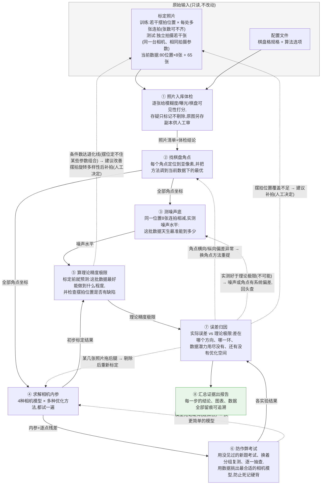

# 项目流程图

> 维护规则:阶段结构/产物契约/回环路径发生变化时,所在阶段的收尾任务必须同步更新本图。
> 任何人看不懂这张图 = 图已过期,必须修。

## 流水线总览(通俗版)

**实线** = 数据流(每一步结果都存成文件,带来源指纹,可独立查看/重跑)
**虚线** = 发现问题后的回头路(只重跑受影响的环节,不用从头再来)

## 阶段契约速查(技术对照)

| 阶段 | 通俗名 | CLI 子命令 | 输入(只读) | 输出产物(`output/`) | 模块 | 需求 |
|---|---|---|---|---|---|---|
| ① | 照片入库体检 | `calib ingest` | input_data/, config/ | manifest.json(每张带全部体检数字与判定来源), suspect_originals/(存疑原图副本), suspect_diff_vs_*.txt(跨轮存疑对比表) | io/ | IO-01~03 |
| ② | 找棋盘角点 | `calib corners` | manifest, 图像, 检测配置 | corners_train/test_×classic/sb.npz(4 份角点;sb 路线含 classic 兜底帧并逐帧记 source 来源), detection_summary.json(检测质量摘要,sb 三口径:纯 SB/兜底/合计), marked_copies/(全部照片的角点标记副本,classic/sb 两套), mosaic/(总览拼图 + 存疑拼图 + 逐格索引), review_sb_failed/(SB 未检出帧:原图+兜底标记+诊断记录), review_suspects/(存疑帧:原图+双检测器标记+中文原因汇总), review_burst_flagged/(连拍点名帧:原图+双检测器标记+波动数值与容差结论)——三个 review 文件夹各为一个文件夹看全的人工复核包,清单为空不生成 | corners/ | COR-01~03 |
| ③ | 测噪声底 | `calib noise` | corners_train_sb.npz / corners_test_sb.npz(血缘回溯同轮 manifest)、manifest.json、input_data 图像 | run_<时间戳>/{noise.json(双口径 σ:检测器口径 + 时域口径,逐姿态来源标注 temporal/immerkaer_transfer,失败轮数值为 null 且写中文原因), injection_displacements.npz(逐张逐档逐重复的角点位移), injection_per_image.json(逐张注入明细), transfer_curve.json(像素噪声→角点误差传递曲线,含 σ=0 校准档), temporal_sigma_per_corner.npz / immerkaer_per_image.npz(逐姿态/逐张明细,各带血缘旁车 meta.json), transfer_curve.png(曲线图)} | noise/ | NOI-01~02 |
| ④ | 求解相机内参 | `calib calibrate` | corners_train/test_*.npz(某检测器口径的角点), manifest.json, 模型/求解器配置矩阵 | run_<时间戳>/ 下每组合一个子目录(目录名 <模型>__<求解器>,如 m2__scipy、m2__scipy_softl1;内含 result.json + extrinsics.npz + residuals.npz 逐帧残差), comparison.json(全矩阵对比摘要), suspect_review/(存疑帧 vs 正常帧逐帧复核:JSON 结论表 + PNG 对比图,复核失败不影响标定结果) | models/, solve/, visualization/ | MOD-01~02, SOL-01, ITER-01 |
| ⑤ | 算理论精度极限 | `calib fisher` | corners_train_sb.npz + manifest.json、noise.json(双口径 σ)、各模型 m{X}__scipy/result.json + extrinsics.npz(线性化点:算误差界时用的那组解) | run_<时间戳>/{crlb.json(16 份 CRLB 记录:4 模型 × 2 观测集 640全帧/80姿态 × 2 σ 口径,逐内参标准差下界 + Σ 敏感性带 + 特征谱/条件数分档 + 软方向 + OpenCV stdDev 交叉验证结论;失败轮数值为 null 且写中文原因), fisher_m{X}.npz(逐模型 Fisher 矩阵明细,各带血缘旁车 meta.json), figures/(逐份记录的特征谱图)} | noise/ | NOI-03 |
| ⑥ | 防作弊考试 | `calib evaluate` | corners_train/test_sb.npz + manifest.json(同轮血缘)、noise.json、各模型标定解(mX__scipy / mX__opencv)、crlb.json(Fisher 预警来源)、config/calibration.yaml | evaluate.json(优化器对比 + test 整体 RMS 选型走查 + 判行表 + 交付), experiments/*.npz(逐折/逐次/逐组明细旁车), figures/(判行表三图)。流程:优化器对比 → 全量重训交付(test 独立照片全模型逐张评分)→ test 整体 RMS 选型(复杂度逐档走查,提升 ≥10% 才升级)→ 四类实验(quick 档只考当选模型、重复缩水:交叉验证 3×3 / bootstrap 50 / 留一抽查 30;full 档全模型全量)→ 三判据第二意见 + 两处一致性对账 | evaluation/ | EVA-01~05 |
| ⑦ | 误差归因 | `calib analyze` | 任意上游产物 | analysis/*.json | analysis/ | ANA-01~04 |
| ⑧ | 汇总证据出报告 | `calib report` / `calib run-all` | 全部产物 | report.html/md, figures/ | visualization/, report/ | REP-01~03, ITER-01~04 |

## 核心设计原则

1. **文件是唯一真相源**:每一步的结果都落盘存证,环节之间只通过文件传递,任何环节都可以单独重跑、单独检查
2. **来源可追溯**:每个结果文件自带"用什么配置、从哪些文件算出来的"指纹,报告里任何数字都能顺藤摸瓜
3. **迭代不从头来**:上游调整后,只重跑受影响的下游环节
4. **回头路有路标**:⑦⑧ 的诊断结论会自动给出"回哪一步、做什么"的建议
