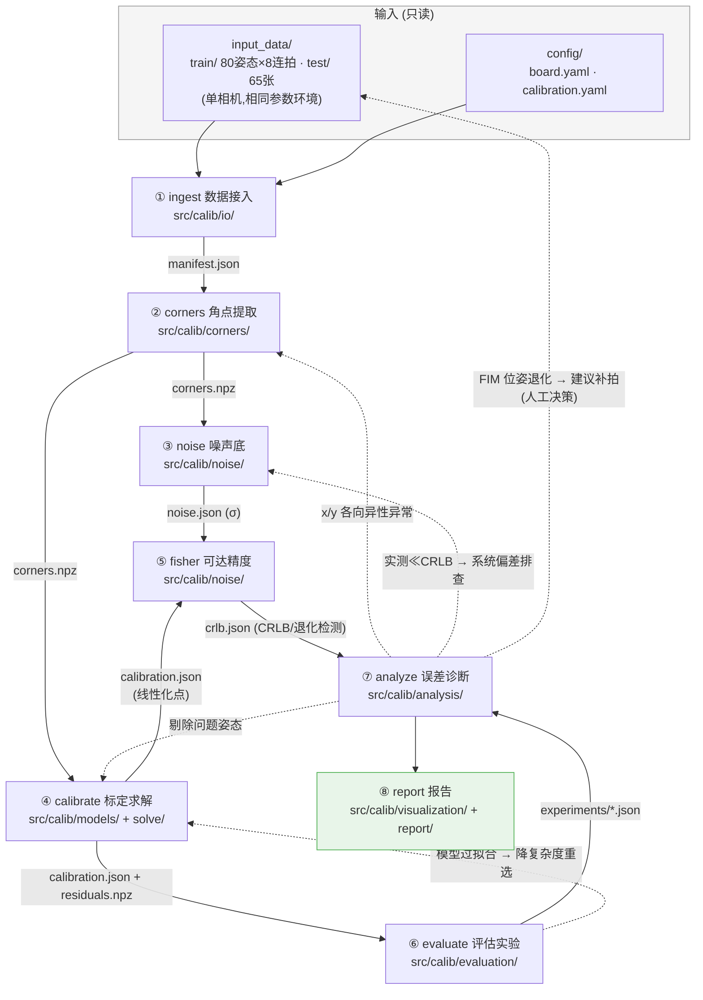

# 项目流程图

> 维护规则:阶段结构/产物契约/回环路径发生变化时,所在阶段的收尾任务必须同步更新本图。
> 任何人看不懂这张图 = 图已过期,必须修。

## 流水线总览(阶段 DAG + 回环)

**实线** = 数据流(产物落盘,带血缘:配置指纹+上游哈希+时间戳)
**虚线** = 迭代回环(诊断 → 回到上游调整 → 增量重跑)

## 阶段契约速查

| 阶段 | CLI 子命令 | 输入(只读) | 输出产物(`output/`) | 模块 | 需求 |
|---|---|---|---|---|---|
| ① ingest | `calib ingest` | input_data/, config/ | manifest.json | io/ | IO-01~03 |
| ② corners | `calib corners` | manifest, 图像, 检测配置 | corners.npz, 检测质量摘要 | corners/ | COR-01~03 |
| ③ noise | `calib noise` | corners.npz, 图像 | noise.json | noise/ | NOI-01~02 |
| ④ calibrate | `calib calibrate` | corners.npz, 模型/求解器配置 | calibration.json, residuals.npz | models/, solve/ | MOD-01~02, SOL-01~02 |
| ⑤ fisher | `calib fisher` | corners.npz, noise.json, 标定结果 | crlb.json | noise/ | NOI-03 |
| ⑥ evaluate | `calib evaluate` | corners.npz, 实验配置 | experiments/*.json, 汇总表 | evaluation/ | EVA-01~05 |
| ⑦ analyze | `calib analyze` | 任意上游产物 | analysis/*.json | analysis/ | ANA-01~04 |
| ⑧ report | `calib report` / `calib run-all` | 全部产物 | report.html/md, figures/ | visualization/, report/ | REP-01~03, ITER-01~04 |

## 核心设计原则(图的语义)

1. **产物是唯一真相源**:阶段间只通过落盘产物通信,任何阶段可独立运行/重跑/检查
2. **血缘可追溯**:每个产物自带配置指纹 + 上游产物哈希,任何数字可回答"从哪来、用什么参数算的"
3. **迭代不重跑全量**:上游调整后仅受影响下游增量重跑(ITER-01)
4. **回环有触发条件**:⑦⑧ 给出的诊断结论自动映射到"回哪一步、做什么"(ITER-04)
