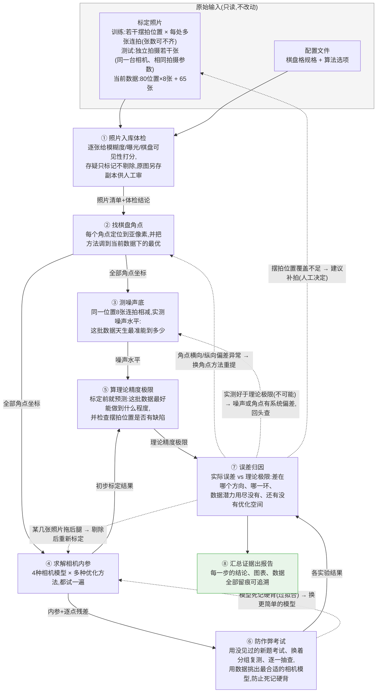

# 项目流程图

> 维护规则:阶段结构/产物契约/回环路径发生变化时,所在阶段的收尾任务必须同步更新本图。
> 任何人看不懂这张图 = 图已过期,必须修。

## 流水线总览(通俗版)

**实线** = 数据流(每一步结果都存成文件,带来源指纹,可独立查看/重跑)
**虚线** = 发现问题后的回头路(只重跑受影响的环节,不用从头再来)

## 阶段契约速查(技术对照)

| 阶段 | 通俗名 | CLI 子命令 | 输入(只读) | 输出产物(`output/`) | 模块 | 需求 |
|---|---|---|---|---|---|---|
| ① | 照片入库体检 | `calib ingest` | input_data/, config/ | manifest.json(每张带全部体检数字与判定来源), suspect_originals/(存疑原图副本), suspect_diff_vs_*.txt(跨轮存疑对比表) | io/ | IO-01~03 |
| ② | 找棋盘角点 | `calib corners` | manifest, 图像, 检测配置 | corners_train/test_×classic/sb.npz(4 份角点), detection_summary.json(检测质量摘要), marked_copies/(全部照片的角点标记副本,classic/sb 两套), mosaic/(总览拼图 + 存疑拼图 + 逐格索引) | corners/ | COR-01~03 |
| ③ | 测噪声底 | `calib noise` | corners.npz, 图像 | noise.json | noise/ | NOI-01~02 |
| ④ | 求解相机内参 | `calib calibrate` | corners.npz, 模型/求解器配置 | baseline_<检测器>_<模型>/calibration.json + residuals.npz(逐帧残差), comparison.json(2×2 对比摘要) | models/, solve/ | MOD-01~02, SOL-01~02 |
| ⑤ | 算理论精度极限 | `calib fisher` | corners.npz, noise.json, 标定结果 | crlb.json | noise/ | NOI-03 |
| ⑥ | 防作弊考试 | `calib evaluate` | corners.npz, 实验配置 | experiments/*.json, 汇总表 | evaluation/ | EVA-01~05 |
| ⑦ | 误差归因 | `calib analyze` | 任意上游产物 | analysis/*.json | analysis/ | ANA-01~04 |
| ⑧ | 汇总证据出报告 | `calib report` / `calib run-all` | 全部产物 | report.html/md, figures/ | visualization/, report/ | REP-01~03, ITER-01~04 |

## 核心设计原则

1. **文件是唯一真相源**:每一步的结果都落盘存证,环节之间只通过文件传递,任何环节都可以单独重跑、单独检查
2. **来源可追溯**:每个结果文件自带"用什么配置、从哪些文件算出来的"指纹,报告里任何数字都能顺藤摸瓜
3. **迭代不从头来**:上游调整后,只重跑受影响的下游环节
4. **回头路有路标**:⑦⑧ 的诊断结论会自动给出"回哪一步、做什么"的建议
